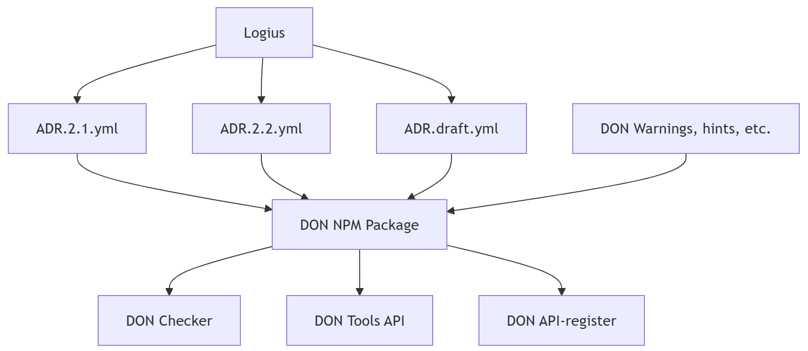

# Nieuwe features developer.overheid.nl
<!-- _class: title -->
 
Dimitri van Hees 
Tom Ootes

## Demo
<!-- _class: title -->

## API Design Rules: hoe zit het ook weer?

## API Design Rules: (uit)fasering

- ADR 2.1 (verouderd)
- ADR 2.2 (huidige standaard)
- ADR draft (werkversie)
- API-register gaat 2.1 én 2.2 scores toekennen en tonen
- API-register toont 2.1 tot bepaalde tijd, daarna 2.2 default
- API-register communiceert dit naar API-providers
- API-providers kunnen aanpassingen doorvoeren...
- ...of accepteren dat er standaard lagere score getoond wordt
- Voorstel: 3 september 2026

## Wat is publiccode.yml

- Dient als flag
- Git-agnostisch
- Beschrijft jouw project, maakt hem vindbaar

## Afsluitend

- Nu hebben we een project voor de API- en OSS-register
- Gebruik de skills, geef ons feedback!
- Mocht je ideeën hebben, vertel het tijdens de rondvraag

## Vragen?
<!-- _class: title -->

## Pauze
<!-- _class: title -->

## Vooruitblik

- Schema register
- AI Skills
- OpenKAT koppeling
- Integratie code.overheid.nl
- Technical debt wegwerken

## Rondvraag
<!-- _class: title -->

## Maar eerst: borrel!
<!-- _class: title -->