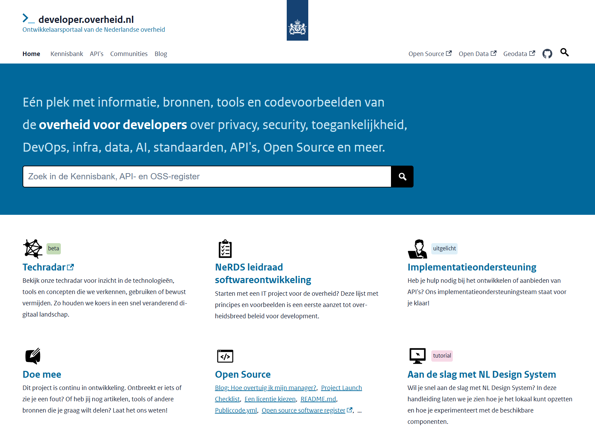
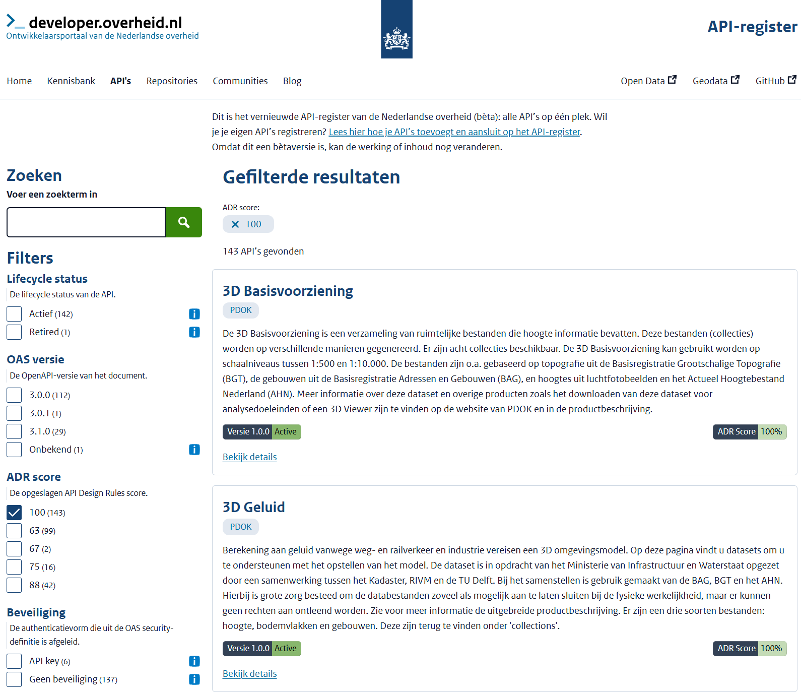
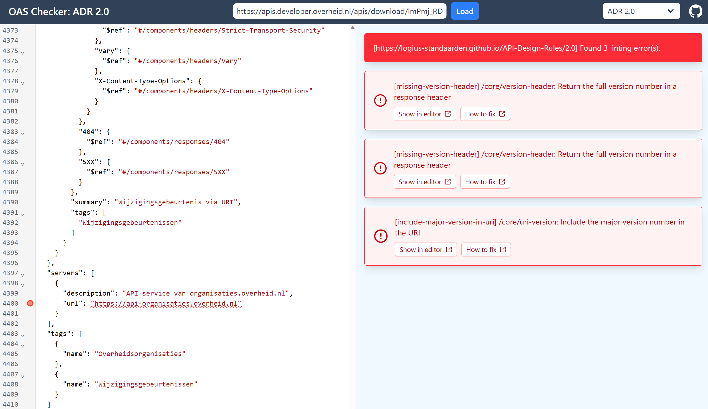
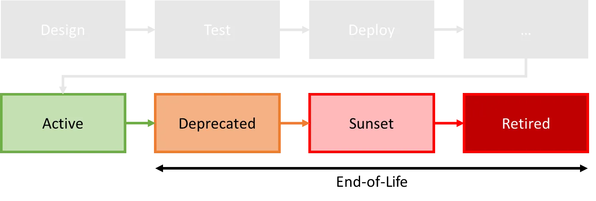
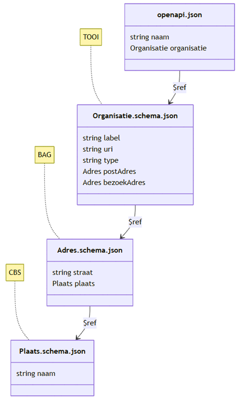
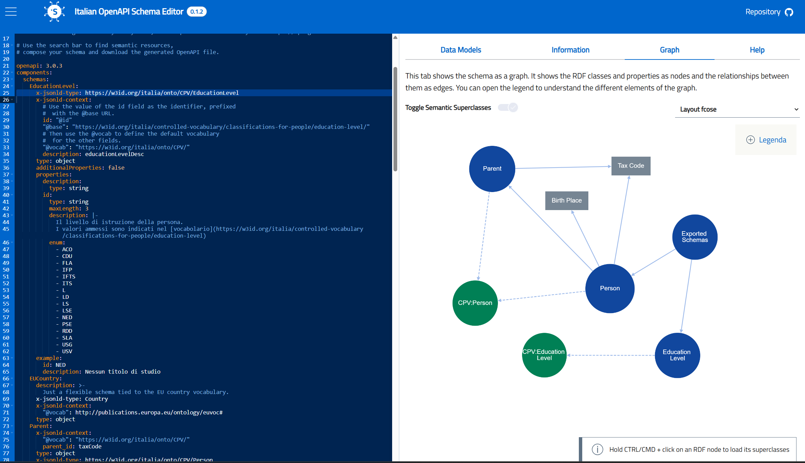
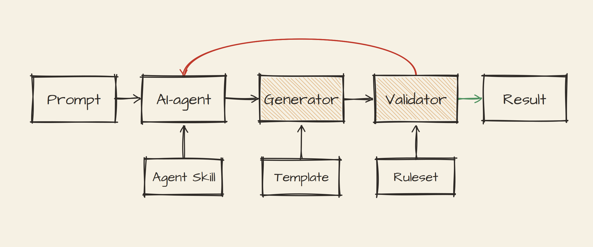
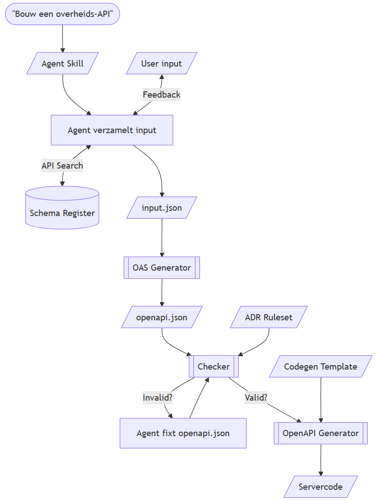
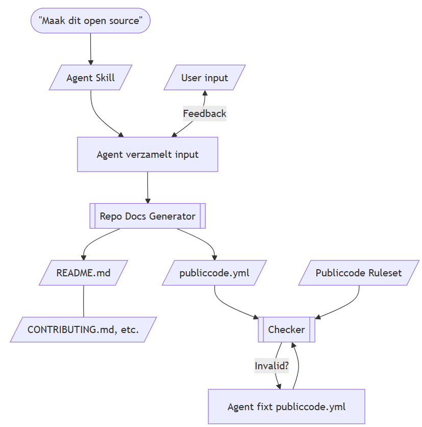
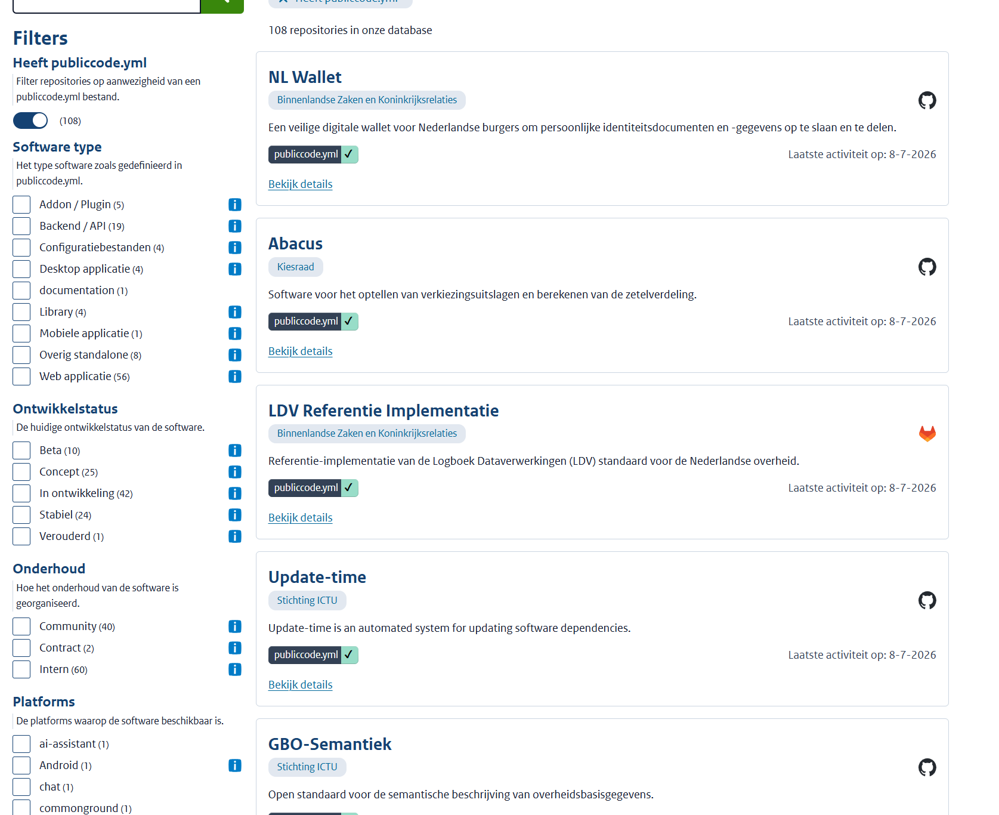

# Building the Front Door to Dutch Government APIs, Schemas and AI
<!-- _class: title -->
<br/>

Dimitri van Hees
FOST München
July 9, 2026

## Dimitri van Hees

- API architect, consumer, provider, developer
- Contributor NL Gov API Strategy
- Product Owner and API architect @ developer.overheid.nl
- Co-owner and beer brewer @ Brouwtoren, Nijmegen

## A quick rewind
<!-- _class: image -->

<!--
- Quick rewind
- Certificate of the Dutch Standardisation Board
- 2018: OpenAPI became the mandatory standard for Dutch gov API
- Birth of a national developer portal idea over pizza and beer in Italy
-->

## Homepage
<!-- _class: image -->

<!--
- Meet: developer.overheid.nl: Developer Portal of the Dutch Government
-->

## Developer portal of the Dutch Government

- Knowledge base
- Blog
- Tools
- API register
- Open Source register
- Agent skills
- Schema register

## Why it's more important than ever
<!--
- Serious incidents with for example the Tax Agency
-->

- Serious incidents with local copies of government data
- "Data at the source" principle
- Dutch National Digital Strategy launched July 2025
- More APIs, more consumers, AI revolution
- Digital autonomy is a top priority in the EU
- Open Source over "Big Tech"

## The API Register
<!-- _class: title -->

## The register today
<!-- _class: image -->


## OpenAPI-first, REST(ish/ful)-only

- 56.3% REST(ish/ful)
- 40.5% Geo-services (WFS/WMS) → OGC API = REST(ish/ful)
- 1.6% OData = REST(ish/ful)
- ~~0.4% GraphQL~~
- ~~1.2% Other (Atom, CKAN, Socrata)~~

## Mandatory standards

- OpenAPI Specification (OAS)
- API Design Rules (ADR)

Both on the Dutch "comply-or-explain" list (Dutch Standardisation Board).

## API Design Rules

- "The `info.contact` details are mandatory in the OAS document"
- "Include major version number in the URI"
- "Don't use trailing slashes"
- Available as Spectral rulesets

## OAS Checker
<!-- _class: image -->


## How to fix
<!-- _class: image -->


## API-lifecycle
<!--
- Missing in OAS and therefore not expressable
- So we've introduced an extension
-->



## API register extensions
<!--
- info.version exploited
- extensions with deprecated and sunset header methodologu, except for the date discussion
-->

```yaml
openapi: 3.0.3
info:
  version: 1.2.3
  x-deprecated: 2025-10-10 # future or past
  x-sunset: 2027-11-11     # future. If past, status is retired
```

## Arazzo support

- Arazzo to Mermaid and Markdown
- Use case: Digital Department of the Environmental Act (DSO)
- Obtaining a permit involves many different APIs

## JSON Schemas
<!-- _class: title -->

## "Comply or explain" status OpenAPI Specification

- OAS 3.0 mandatory since 2018
- OAS 3.1 upgrade process started in 2022
- Upgrade approved last June
- OAS 3.1 mandatory from October 2026

## We share more than we reuse
<!--
- in the meantime we kept reinventing the wheel
- don't forget address: example where street and housenumber are in separate fields or in 1 field
-->

- Hundreds of public-sector APIs
- All describe the same things: organisations, addresses, persons, dates, errors
- Each team reinvents the same schemas
- All do it slightly different

## Reusable schemas to the rescue
<!-- _class: image -->
<!--
- Resuable JSON schemas to the rescue
-->


## The Schema Register
<!-- _class: title -->

## Features

- **Two layers**: JSON Schemas (data shapes) + OpenAPI components (headers, parameters, responses)
- **Discoverability**: search across all reusable schemas and components
- **Reusability**: `$ref` from any OAS
- **Versioning**: semver, with clear deprecation
- **Documentation**: human-readable docs alongside the JSON
- **Codegen**: TypeScript types, Java classes, etc.

## Schema Design Rules

- Apart from API Design Rules
- Separation of Concerns between OpenAPI and Schema
- "Provide a top-level example"
- "Property names must be `lowerCamelCase`"
- "Description is mandatory"
- "Abbreviations must be explained in the description"
- "Use `x-jsonld-type` keyword for semantic enrichment"

## Semantic enrichment
<!-- _class: image -->
<!--
- Add Linked Data context and to schemas
- Way to bridge the gap between Linked Data and APIs
- Inspired by Italian colleagues
-->



## "Tools in the loop"
<!-- _class: title -->
<!--
- Here comes the Agentic era
-->

## Tools in the loop: "Human in the loop" gets help



## The principle

- **Generators** do the heavy, repetitive work - deterministic
- **Validators** answer the truth question: "does this comply?"
- **CLI** is the natural interface for agents: exit code = signal to iterate
- **AI** interprets intent and orchestrates - not the oracle of truth

## Ingredients

- **API Design Rules (ADR)** - how APIs must behave
- **Schema Design Rules (SDR)** - how schemas must be written
- **API Register** - the canonical list of government APIs
- **Schema Register** - reusable JSON Schemas & OAS components
- **Agent Skills** - instructions the AI can load and follow

## Tools

- **OAS Generator**: boilerplate `openapi.json` from `input.json`, ADR-conform by default
- **Checker**: lints/validates documents against rulesets (e.g. ADR Spectral ruleset)
- **Codegen Templates**: OpenAPI Generator templates (Java, Go, Node.js, Rust, Python)

## The build loop
<!-- _class: image -->


## Tools in the loop: not only for APIs

- The pattern: skill → generator → validator → deterministic result
- Swap the ruleset, and it works for anything with rules
- The obvious next candidate: making your project open source

## The publish loop
<!-- _class: image -->
<!--
- This works because there is also a standard for open sourcing
- Here comes publiccode
-->



## publiccode.yml
<!-- _class: title -->

## "OAS for Open Source repositories"

- Machine-readable metadata for public sector open source
- Collaboration with EU, Italy, Brussels
- Syncs with the European Commission's Open Source Portal

## publiccode-first in the OSS Register

- Every published project has a `publiccode.yml`
- The register reads it as its source of truth
- Enables discovery, reuse, dependency scanning, health checks
- Rich filtering: by license, category, tech stack, maturity level

## oss.developer.overheid.nl
<!-- _class: image -->


## Standards are the foundation

- Templates, generators and validators exist because standards exist
- Every rule you write down is a piece of truth you can hand off to deterministic tooling
- More standardisation → tighter generators, sharper validators, fewer hallucinations (and consumed tokens)
- The model does language and intent; the tools do truth

## Thank you!
<!-- _class: title -->
<br/><br/>
Dimitri van Hees
E-mail: <d.vanhees@geonovum.nl>
LinkedIn: <https://www.linkedin.com/in/dimitrivanhees/>
Slides: <https://dvh.github.io/slideshows/20260709-fost>
Github: <https://github.com/developer-overheid-nl>
