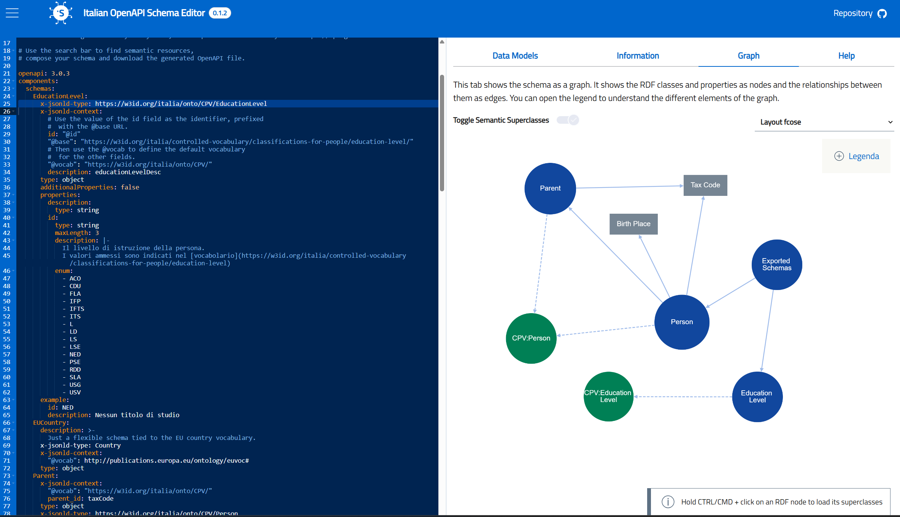

# JSON Schema: Register & Design Rules
<!-- _class: title -->
<br/>

Dimitri van Hees
Kennisplatform API's
5 november 2026

## Het Schema-register is live: https://schemas.developer.overheid.nl
<!-- _class: title -->

<!--
- Alle JSON Schema's van de Nederlandse overheid op één plek
- Status: bèta
- Demo
-->

## Wat het register doet

- Zoeken en filteren over alle schema's
- URL's om met `$ref` naar te verwijzen
- Health: score en issues per schema, met JSON pointer
- Dependencies: welke schema's naar elkaar verwijzen
- Documentatie en download naast de JSON
<!--
- Inspiratie: DVLA (Britse RDW) met herbruikbare bouwblokken zoals adres
-->

## Status: bèta

- `$ref` naar het register: prima tijdens het ontwerpen
- Voor productie: het schema kopiëren of bundelen
- URL's, schema's, versionering en bestandsnamen kunnen nog wijzigen
- Het register heeft hiervoor een melding op elke pagina

## Experiment: alle schema's uit het API-register
<!-- _class: title -->
<!--
- Alle schema's uit alle API's in het API-register geëxtraheerd, ook geneste en inline
- Experiment, niet de bedoeling het register zo te vullen
- Demo: <https://schemas.don.projects.digilab.network/>
- Elk schema uit elke API in het API-register geëxtraheerd
- Ook geneste en inline schema's
- Geen manier om het register te vullen, wel een spiegel
-->

## Wat we zagen

- Veel schema's zonder `title` of `description`: wat is dit eigenlijk?
- Veel verschillende schema's: zelfde structuur, andere annotaties
- Foutmeldingsschema's talloze keren, terwijl problem+json één keer zou moeten bestaan
- Examples die niet kloppen met het type, zoals een integer bij `type: string`

## Gevolg

- Tientallen manieren om een adres te modelleren
- Een schema dat je niet begrijpt, hergebruik je niet (en een AI agent ook niet)
- Elk team vindt hetzelfde wiel opnieuw uit
- Elke afnemer schrijft per API eigen code om bijvoorbeeld adressen om te zetten
- Een register vol varianten is geen register maar een archief

## Schema Design Rules (SDR)
<!-- _class: title -->

## Vanaf 1 januari: OpenAPI 3.1!
<!-- _class: title -->

<!--
- OAS 3.1 per 1 januari 2027 de verplichte standaard
- 3.1 = volledige ondersteuning van JSON Schema 2020-12
- Schema's worden daarmee een volwaardig onderdeel van elke API
-->

## Wat 3.1 mogelijk maakt: één structuur, eigen annotaties

Op test: één GeoJSON Polygon, honderden varianten

- Gebouw en postcodegebied: zelfde structuur, andere `description` en `examples`
- Sinds 2020-12 mogen annotaties naast een `$ref` staan, zonder `allOf`

```json
{
  "contour": {
    "$ref": "https://<organisatie>/<standaard>/<versie>/Polygon.schema.json",
    "description": "De contour van het gebouw."
  }
}
```
<!--
- In de kick-off besproken opties: lokaal schema met allOf, $ref met eigen annotaties, OpenAPI overlays
- Overlays werken alleen op OpenAPI-documenten
- Zelfde vraag speelt bij vertalingen
-->

## De ADR kan zeggen "gebruik JSON Schema", de SDR zegt hoe

- OpenAPI zegt niets over wat er in het `schema`-veld staat
- De ADR daardoor tot nu toe ook weinig
- JSON Schema wordt breder gebruikt dan OpenAPI
- Dus: een eigen set afspraken, naast de ADR

## Breder dan OpenAPI

- OpenAPI en AsyncAPI
- Validators
- Generators: TypeScript-types, classes, formulieren, documentatie
- AI: genereren van code en data, valideren van output
- Eenduidige schema's maken dit betrouwbaar
- Extensies overheidsbreed standaardiseren
<!--
- Inconsistenties komen terug in alles wat je genereert
- AI: eenduidiger schema, betere output en toetsing
- Extensies: alleen via de SDR overheidsbreed te standaardiseren
-->

## Samenhang met de ADR

- **ADR**: URL-paden, queryparameters, gedrag van de API
- **SDR**: request- en response-bodies, berichten, gegevensstructuren
- Eén laag dieper, zelfde aanpak

## Verhuizen vanuit de ADR

Regels die over bodies gaan en dus naar de SDR kunnen, waarna de ADR ernaar verwijst:

- Veldnamen: geen afkortingen, Nederlandse naamgeving (of niet)
- De resourcenaam niet herhalen in een veldnaam (of wel)
- Property casing, destijds bij de ADR geparkeerd
- Formats, zoals de OpenAPI Format Registry die de ADR nu gebruikt (#694)

## Verhuiskandidaten: open ADR-issues

| Issue | Onderwerp | SDR |
|-------|-----------|-----|
| #336 | `property-casing` botst met JSON-LD | #699 |
| #198 | `property-casing` uitbreiden | #699 |
| #341 | Semantiek van `null` en afwezige properties | nieuw |
| #289 | `date-time` nauwkeuriger dan seconden | #694 |

<!--
- Logius-standaarden/API-Design-Rules, open issues op 05-11-2026
- #198: alleen het deel over properties; path- en queryparameters blijven bij de ADR
- #341: het schemadeel (nullable, required); de PATCH-semantiek blijft bij de ADR
- Twijfel: #348 JSON-FG in de Geospatial-module, gaat over geometrie in bodies
- Blijft bij de ADR, zelfde gedachte als #687: #338 info.description en info.summary verplicht
- Gesloten maar relevant: #340, casing van schemanamen en properties niet in de regellijst
-->

## Wat de SDR opleveren

1. Het **schemaregister** biedt meerwaarde: hergebruik, links, toetsing
1. Schema's zijn **geschikt voor AI**: genereren en valideren
1. Schema's zijn **productieklaar**

Dit zijn ook de toetsstenen voor elke regel.

## De werkgroep
<!-- _class: title -->

## Werkgroep Schema Design Rules

- Nieuwe werkgroep van het Kennisplatform API's
- Kick-off op 28 oktober bij Geonovum
- Geonovum, Gemeente Amsterdam, VNG, Logius
<!--
- Aanwezig: Yashar Robert (Amsterdam), Henri Korver en Michiel Trimpe (VNG), Tim van der Lippe (Logius), Joost Farla (Geonovum), ikzelf als voorzitter
-->

## Uitgangspunten

- Klein beginnen: een versie 0.1 met concrete regels
- Een overheidsprofiel bovenop JSON Schema
- Register en regels staan los van elkaar: elke regel moet ook buiten het register te onderbouwen zijn
- Niet botsen met informatiemodellen (MIM)
- Versionering in scope, maar niet blokkerend voor 0.1

## Werkwijze

- Zoals de ADR: repository bij het Kennisplatform API's
- Eén GitHub-issue per onderwerp
- Elk issue start met een concreet voorstel
- Regeltekst in het Engels, met MUST / SHOULD / MAY
- Uitgewerkt in een ruleset

## Toetsset

Bestaande schema's om de regels aan te toetsen:

- problem+json
- CloudEvents
- BAG (Gemeente Amsterdam)
- VNG: adres, persoon, bedrijf, zaak
- PDOK, OGC en Kadaster

Faalt een algemeen gewaardeerd schema op één regel? Dan heroverwegen we de regel.

**Draag schema's aan uit andere domeinen**, ook OpenAPI-schema's die nog geen los JSON Schema zijn. Hoe breder de toetsset, hoe beter de regels.

## Ter inspiratie: regels van Sourcemeta One
<!-- _class: title -->
<!--
- Ingebouwde regels van Sourcemeta One, doorgelopen in de kick-off
- Nog niets besloten: illustratie van waar je aan moet denken
- Triage per regel is huiswerk van de werkgroep
- Tempo houden, niet bespreken
-->

## Annotaties en voorbeelden

<style scoped>table { font-size: 0.5em; }</style>

| Regel | Omschrijving |
|-------|--------------|
| `top_level_title` | Beknopte title op topniveau |
| `top_level_description` | Description op topniveau |
| `top_level_examples` | Examples op topniveau |
| `valid_examples` | Examples valideren tegen het schema |
| `valid_default` | Default valideert tegen het schema |
| `duplicate_examples` | Geen dubbele examples |
| `title_description_equal` | Title en description niet gelijk |
| `title_trailing_period` | Geen punt aan het eind van een title |
| `description_trailing_period` | Geen punt aan het eind van een description |
| `title_trim` | Geen witruimte rond een title |
| `description_trim` | Geen witruimte rond een description |
| `comment_trim` | Geen witruimte rond een comment |

<!--
- Hier komen #687 en #689 vandaan
-->

## Interoperabiliteit en hergebruik

<style scoped>table { font-size: 0.5em; }</style>

| Regel | Omschrijving |
|-------|--------------|
| `invalid_external_ref` | Externe `$ref` moet resolven |
| `definitions_to_defs` | `$defs` in plaats van `definitions` |
| `unnecessary_allof_ref_wrapper_modern` | Geen `allOf` om een `$ref` (2019-09 en later) |
| `unnecessary_allof_wrapper` | Niet-conflicterende keywords uit `allOf` halen |
| `unnecessary_extends_wrapper` | Niet-conflicterende keywords uit `extends` halen |
| `simple_properties_identifiers` | Propertynamen te mappen naar programmeertalen |
| `portable_anchor_names` | Anchors binnen veilige tekenset |
| `pattern_non_ecma_regex` | `pattern` alleen in ECMA-262 |
| `pattern_properties_non_ecma_regex` | Keys van `patternProperties` alleen in ECMA-262 |
| `unknown_format_prefix` | Alleen `format`-waarden uit de specificatie |

<!--
- invalid_external_ref: #691
- unnecessary_allof_ref_wrapper_modern: de polygon-casus
- simple_properties_identifiers: raakt aan casing (#699)
-->

## Tegenstrijdig of onvervulbaar

<style scoped>table { font-size: 0.5em; }</style>

| Regel | Omschrijving |
|-------|--------------|
| `conflicting_readonly_writeonly` | Niet tegelijk `readOnly` en `writeOnly` |
| `const_not_in_enum` | Niet tegelijk `const` en `enum` |
| `forbid_empty_enum` | Geen lege `enum` |
| `enum_to_const` | `enum` met één waarde wordt `const` |
| `equal_numeric_bounds_to_const` | Gelijke `minimum` en `maximum` wordt `const` |
| `incoherent_min_max_contains` | `minContains` niet groter dan `maxContains` |
| `unsatisfiable_max_contains` | `maxContains` boven de arraygrens is zinloos |
| `unsatisfiable_min_properties` | `minProperties` onder aantal `required` is zinloos |

## Overbodige constraints

<style scoped>table { font-size: 0.5em; }</style>

| Regel | Omschrijving |
|-------|--------------|
| `properties_default` | Lege `properties` |
| `pattern_properties_default` | Lege `patternProperties` |
| `property_names_default` | Lege `propertyNames` |
| `property_names_type_default` | `type: string` in `propertyNames` |
| `items_array_default` | Lege array als `items` |
| `items_schema_default` | `true` als `items` |
| `unevaluated_items_default` | `true` als `unevaluatedItems` |
| `unevaluated_properties_default` | `true` als `unevaluatedProperties` |

## Overbodige constraints

<style scoped>table { font-size: 0.5em; }</style>

| Regel | Omschrijving |
|-------|--------------|
| `content_schema_default` | `true` als `contentSchema` |
| `dependencies_default` | Lege `dependencies` |
| `dependent_required_default` | Lege `dependentRequired` |
| `disallow_default` | Lege array als `disallow` |
| `divisible_by_default` | `divisibleBy: 1` |
| `multiple_of_default` | `multipleOf: 1` |
| `then_empty` | Leeg schema als `then` |
| `else_empty` | Leeg schema als `else` |

<!--
- disallow, divisibleBy, dependencies: oude drafts
-->

## Voorselectie op GitHub
<!-- _class: title -->
<!--
- Uit de Sourcemeta-regels hebben we al een voorselectie gemaakt
- Plus een beginnetje van andere regels en de moeilijke onderwerpen
- Alles staat als issue op GitHub: meedoen kan meteen
-->

## Quick wins

- #687 `title` en `description` verplicht
- #688 Contactinformatie in het schema
- #689 Examples moeten valideren tegen het schema
- #690 Bestandsnamen: `UpperCamelCase.schema.json`
- #691 Externe `$ref` moet resolven

## Moeilijke onderwerpen

- #692 Versionering
- #693 Custom extensions en annotaties: semantiek, `unit`, `provenance`
- #694 Formats en eenheden
- #695 `$id` en `$schema`: verplicht, en op welk niveau
- #696 Dialect voorschrijven en mixen van versies
- #697 Nesten versus aparte definition
- #698 Discriminators en polymorfie
- #699 Veldnamen en property casing

## Extensies: de `x-`-prefix

- Mogelijke extensies: semantiek, extra formats, `unit`, `provenance`, contact
- Doet iedereen het op dezelfde manier, dan kun je er tooling omheen bouwen
- Volgende versies van JSON Schema: onbekende keywords niet meer toegestaan, tenzij met `x-`-prefix
- Daar sorteren we op voor: extensies krijgen altijd een `x-`-prefix
- Open: naam en inhoud per extensie (#693)

## Voorbeeld: semantiek in Italië
<!-- _class: image -->

<!--
- Ter illustratie van een extensie, niet als voorstel
- Italië: x-jsonld-extensie (nog OAS 3.0) die verwijst naar linked data in hun SPARQL-endpoint
- Demo in de kick-off: https://teamdigitale.github.io/dati-semantic-schema-editor/latest/
- x-jsonld koppelt velden aan begrippen, JSON Schema blijft JSON Schema
- Brede behoefte aan een haakje tussen API-schema's en de semantische laag, ook bij Justitie en Veiligheid
- Discussie in #693
-->

## Van SDR naar ruleset
<!-- _class: title -->
<!--
- De SDR worden verwerkt in een ruleset, net als de ADR
- Die ruleset linten we met: OpenLint!
-->

## OpenLint 1.0
<!-- _class: title -->
<!--
- Groot nieuws sinds gisteren
-->

## Wat is OpenLint?

- Opvolger van Spectral: opgeschoonde kloon van de fork onder API Commons
- Rulesetformaat losgemaakt van de linter, met een eigen specificatie
- Komt onder Open Source Europe
- Nederland is aan boord via developer.overheid.nl, samen met onder meer Italië en Duitsland
<!--
- Aanleiding juli: kwaadaardige versies van @asyncapi/specs, een dependency van Spectral
- Issue bleef wekenlang onbeantwoord, honderden open issues, VS Code-plugin niet bijgewerkt
- DON Checker was op een veilige versie gepind
- Specificatie op openlint.org/spec
-->

## Versie 1.0 staat op npm

- Rulesetformaat blijft gelijk: bestaande rulesets werken zonder aanpassingen
- Ook de ADR-ruleset
- Alle tooling van developer.overheid.nl draait er nu op, ook de DON Checker
- Spectral rechtstreeks gebruikt? Vervang de package door `openlint`
- Nog beter: gebruik de DON Checker

## Meer dan OpenAPI

- Nu: OpenAPI, AsyncAPI, Arazzo
- Ambitie: meer formaten, waaronder JSON Schema
- Daarna: LSP voor elke editor, compliance met vacuum
- **De Schema Design Rules worden de usecase voor JSON Schema in OpenLint**
<!--
- Mooi haakje: wat we in de werkgroep afspreken, wordt direct een ruleset
- Die ruleset helpt OpenLint om JSON Schema-ondersteuning vorm te geven
- Meedoen: github.com/openlint/community, Office Hours
-->

## Samengevat: doe mee
<!-- _class: title -->
<!--
- Vragen graag, maar geen inhoudelijke discussie hier
- We beslissen vandaag niets
- De discussie loopt op GitHub, zodat iedereen kan meelezen en meedoen
-->

## Lees de blogpost over OpenLint
<!-- _class: qr -->


- Meer over OpenLint 1.0 en wat er nog komt

<https://developer.overheid.nl/blog/2026/11/04/openlint-vervangt-spectral>

## Discussieer mee op GitHub
<!-- _class: qr -->


Reageer op de bestaande SDR-issues, of maak een nieuw issue aan

Label `WG: Schema design rules` op Geonovum/KP-APIs

Geen bezwaar op een voorstel? Dan geldt het als voorlopig aangenomen.

[github.com/Geonovum/KP-APIs/issues](https://github.com/Geonovum/KP-APIs/issues?q=label%3A%22WG%3A%20Schema%20design%20rules%22)

## Zo voeg je een schema toe
<!-- _class: qr -->


1. Pull request op `developer-overheid-nl/don-static`
1. Schema in een collectie onder `assets/schemas`, zoals `adr` of `don`
1. Zorg voor `$schema`, `title` en `description`

<https://github.com/developer-overheid-nl/don-static/tree/main/assets/schemas>
<!--
- Tot en met december gaat het zo. We beginnen met onze eigen schema's, zoals problem+json uit de ADR.
- Collectie = map met eigen baseUri op static.developer.overheid.nl
- Onze eigen schema's volgen al UpperCamelCase.schema.json (#690)
-->

## Haak aan bij de werkgroep

Mail naar <api@geonovum.nl>

## Vragen?
<!-- _class: title -->
<br/><br/>
Dimitri van Hees
E-mail: <d.vanhees@geonovum.nl>
Slides: <https://dvh.github.io/slideshows/20261105-schema-register>
