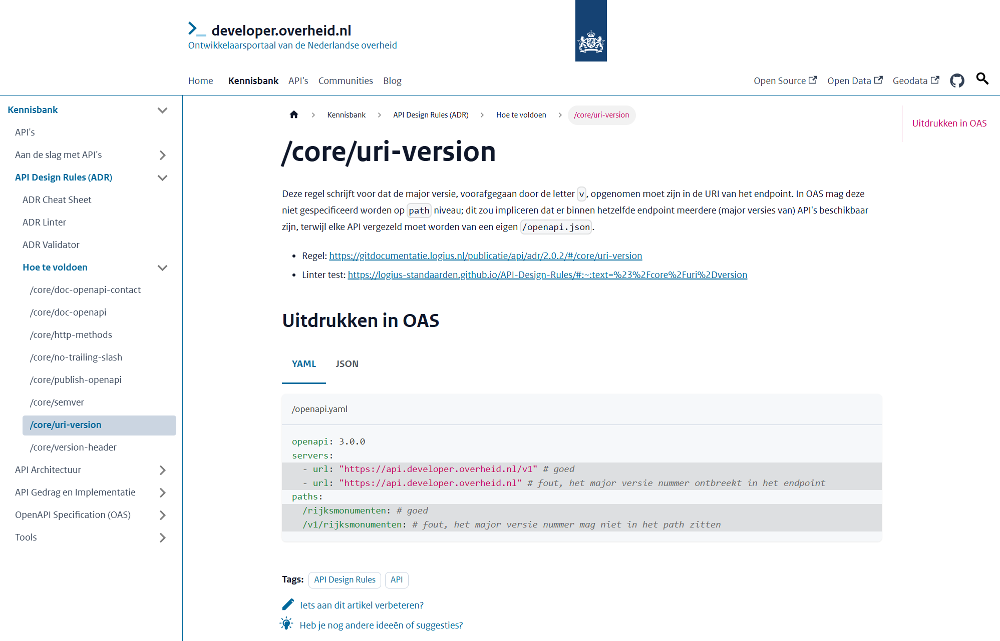
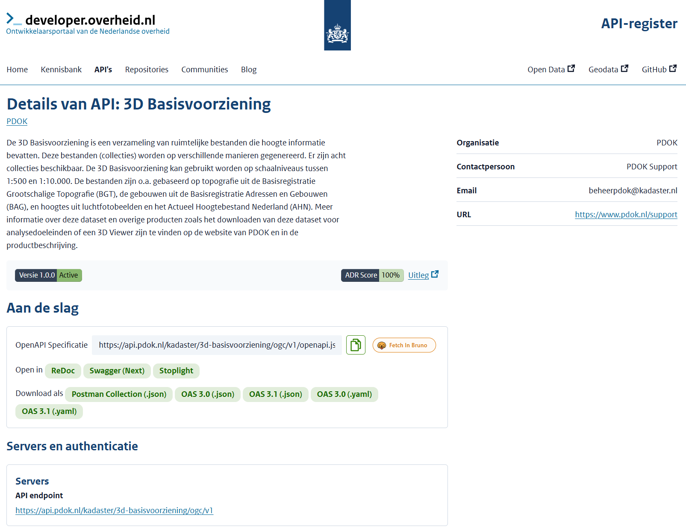
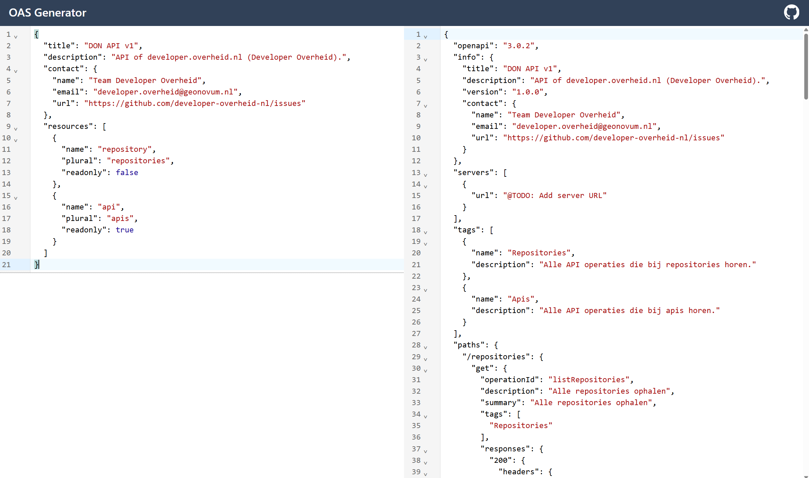
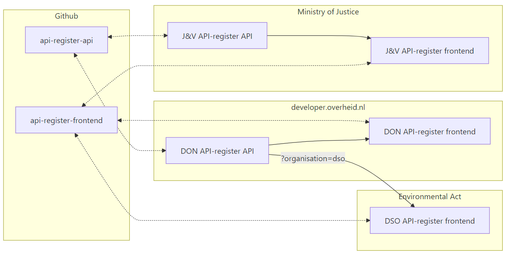

# Building the Front Door to Dutch Government APIs
<!-- _class: title -->
<br/>

Dimitri van Hees
FOST Amsterdam
June 2026

## Dimitri van Hees

- API architect, consumer, provider, developer
- Contributor NL Gov API Strategy
- Product Owner and API architect @ developer.overheid.nls
- Co-owner and beer brewer @ Brouwtoren, Nijmegen

## A quick rewind
<!-- _class: image -->

<!--
- Story started in 2013, picked up again seriously in 2018
- 2018: OpenAPI became the mandatory standard for Dutch gov APIs
- Birth of a national developer portal idea over pizza and beer in Italy
- 2023: back to bring developer.overheid.nl to the next level
- Today: from "yet another catalog" to the front door for Dutch gov APIs
-->

## What is a developer portal?
<!-- _class: title -->

## More than a catalog

- "A developer portal provides a central place for developers to discover and use services."
- "**It's not simply an API catalog.** It comprises more than a list of API specs and documentation."
- "It's a **central place for developers to go and learn** about the systems they work on."
- "It provides **self-service tools** to get devs integrated quickly and easily."
- "And it gives folks **a place to go when they have questions**."

<https://www.opslevel.com/resources/developer-portals-what-are-they-and-why-do-you-need-them>

## developer.overheid.nl
<!-- _class: title -->

## Homepage
<!-- _class: image -->


## What's inside

- Knowledge base
- Blog
- Tools
- Open Source register
- API register
- Schema register

## Two audiences, one platform

**For developers building on government APIs:**

- Find the right API
- Understand the rules of the road (ADR)
- Self-serve docs, SDKs, mocks
- Know when things change

**For government organisations publishing APIs:**

- A single, consistent place to be found
- Free tooling and validation
- Standardisation without losing autonomy

## Why it's more important than ever

- Serious incidents with local copies of government data
- "Data at the source" principle
- Digital autonomy is now a top priority in the EU
- Dutch National Digital Strategy launched July 2025
- More APIs, more consumers, higher stakes

## The new API Register
<!-- _class: title -->

## The register today
<!-- _class: image -->


## REST-only, OpenAPI-first
<!-- 244 OpenAPI specs in the register; still growing -->

- 140 REST(ish/ful)
- 100 Geo-services (WFS/WMS) → OGC API = REST
- 4 OData = REST
- ~~1 GraphQL~~
- ~~3 Other (Atom, CKAN, Socrata)~~

## Mandatory standards

- **OpenAPI Specification (OAS)**
- **REST API Design Rules (ADR)**

Both on the Dutch "comply-or-explain" list, governed by Forum Standaardisatie and Logius.

## What we get from OAS

- Name & description (`info`)
- Contact info (`info.contact`)
- Environments (`servers`)
- Security (`securitySchemes`)
- Examples for mocking and code generation
- JSON Schemas (proper, from OAS 3.1)

## How it works

1. `POST` URL of the OAS document to our _API register API_
1. Validate OAS and presence of a `contact` object
1. If valid, add the URL to the register
1. Make a local dereferenced copy of the OAS
1. Convert 3.0 ↔ 3.1, YAML ↔ JSON
1. Generate goodies (SDKs, Bruno, Postman, etc.)
1. Validate against the API Design Rules → score
1. Poll for changes; on change, return to step 4

## Adding an API

```json
// POST https://api.developer.overheid.nl/api-register/v1/apis HTTP/1.1
// Content-Type: application/json

{
  "oasUri": "https://api.standaarden.overheid.nl/v1/openapi.json"
}
```

## No `info.contact` in OAS

```json
// HTTP/1.1 400 Bad Request
// Content-Type: application/problem+json

{
  "type": "https://apis.developer.overheid.nl/12345/spec#400",
  "title": "Bad Request",
  "status": 400,
  "detail": "Contact info could not be extracted from OAS",
  "errors": [
    { "name": "contact.name",  "reason": "Missing" },
    { "name": "contact.email", "reason": "Missing" },
    { "name": "contact.url",   "reason": "Missing" }
  ]
}
```

## API Design Rules (ADR)
<!-- _class: title -->
<!--
- We can't centralize legislation, but we can centralize HOW gov APIs work
- Discussions about versioning, pagination, body or header links: toss a coin
- Don't care HOW, but that we all do it the SAME
- Mandatory alongside the OpenAPI Specification
-->

## Why design rules matter

- It doesn't matter HOW we do it, as long as we all do it the **same**
- Enables generic tooling
- Saves discussion time
- Migration paths shared across hundreds of APIs
- Better Developer Experience for client devs **and** API devs

## OAS Checker
<!-- _class: image -->


## How to fix
<!-- _class: image -->


## From validation to insight

- Per-API compliance score
- Impact analysis before introducing a new rule
- Trends per organisation, per rule
- Yearly report for Forum Standaardisatie

## API Lifecycle
<!-- _class: title -->

## End-of-life phase
<!-- _class: image -->


## Versioning, statuses and the runtime gap

- Exploit `info.version` for the current semver of the API
- RFC 9745 (`Deprecation` / `Sunset` headers) is a runtime answer
- We work OpenAPI-first (design-time)
- Workaround: API register extensions

## API register extensions

```yaml
openapi: 3.0.3
info:
  version: 1.2.3
  x-deprecated: 2025-10-10 # future or past
  x-sunset: 2027-11-11     # future. If past, status is retired
```

## API statuses

- `Active`
- `To be deprecated`
- `Deprecated`
- `Sunset`
- `Retired` (you can't `DELETE` an API from the register)

## Subscribe to API

- Good old RSS
- Slack: `/feed subscribe https://api.developer.overheid.nl/api-register/v1/apis/dicF0B3HR/feed.rss`
- Notifications on changes in lifecycle, design, ADR score, uptime, etc.

## Beyond the register
<!-- _class: title -->

## API detail page (badges)
<!-- _class: image -->


## OAS generator
<!-- _class: image -->


## Separate repositories

- Easier to reuse
- Easier to manage
- Easier to contribute
- Easier to "mix & match"

## Mix & match
<!-- _class: image -->


## Frontend

- Built on NL Design System
- Government branding components
- WCAG compliant
- Aware of API design (the frontend "speaks OAS")

## Where it's headed

- Stable and compliant landscape
- JSON Schema & components register
- Launching customer of `code.overheid.nl`
- Tooling improvements

## Thank you
<!-- _class: title -->
<br/><br/>
Dimitri van Hees
E-mail: <d.vanhees@geonovum.nl>
LinkedIn: <https://www.linkedin.com/in/dimitrivanhees/>
Slides: <https://dvh.github.io/slideshows/fost-amsterdam-don>
Github: <https://github.com/developer-overheid-nl>
