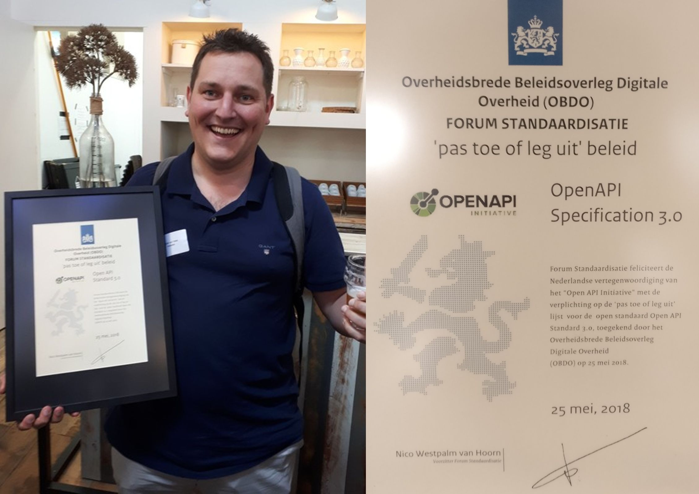
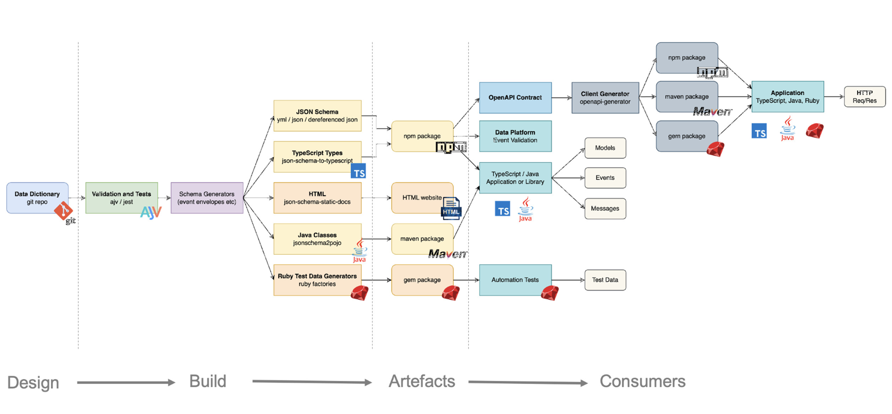
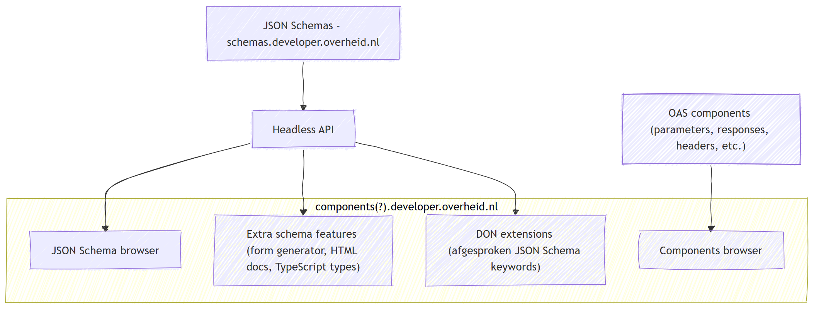

# A National Schema Register: Reusable Components for Government API Design
<!-- _class: title -->
<br/>

Dimitri van Hees
FOST Amsterdam
June 2026

## Dimitri van Hees

- API architect, consumer, provider, developer
- Contributor NL Gov API Strategy
- Product Owner and API architect @ developer.overheid.nls
- Co-owner and beer brewer @ Brouwtoren, Nijmegen

## The problem
<!-- _class: title -->

## We share more than we reuse

- Hundreds of public-sector APIs
- All describe the same things: organisations, addresses, persons, dates, errors
- All do it slightly differently
- Each team reinvents the same JSON Schemas
- Each consumer writes the same mapping code

## What "slightly differently" looks like

- Address as a flat string vs. structured object
- "Organisation" identified by chamber-of-commerce number, OIN, or a TOOI URI
- Error responses: plain JSON, RFC 7807, or homegrown
- Money as `number`, `string`, or `{amount, currency}`
- Examples

## Why this matters

- More integration code, more bugs
- Harder to combine APIs into workflows
- Harder to generate types, SDKs, validators
- Harder to teach: "what does *good* look like?"
- Harder to enforce standards if there's nothing canonical to reuse

## The PTOLU connection
<!-- _class: image -->

<!--
- PTOLU = comply or explain
- We've standardised HOW we describe APIs (OAS) and HOW they behave (ADR)
- Missing piece: WHAT goes inside the schemas
-->

## The Schema Register
<!-- _class: title -->

## schemas.developer.overheid.nl
<!-- _class: image -->


## What it offers

- **Discoverability**: search across all reusable schemas and components
- **Reusability**: `$ref` from any OAS
- **Versioning**: semver, with clear deprecation
- **Documentation**: human-readable docs alongside the JSON
- **Codegen**: TypeScript types, Java classes, etc.
- **Schema Design Rules**: to push standardisation further

## Two layers: schemas and components

- **JSON Schemas**: pure data shapes (`address.json`, `organisation.json`)
- **OpenAPI components** OAS-specific reusable bits (headers, parameters, responses)

## Inspiration: DVLA
<!-- _class: image -->

<!--
- The UK's DVLA pioneered a similar register
- We're building on that pattern, adapted to the Dutch governance context
-->

## How an OAS uses it

```json
{
  "/beers/{id}": {
    "get": {
      "responses": {
        "200": {
          "content": {
            "application/json": {
              "schema": {
                "$ref": "https://schemas.developer.overheid.nl/beer.json"
              }
            }
          }
        }
      }
    }
  }
}
```

## A reusable schema

```json
{
  "$schema": "https://json-schema.org/draft/2020-12/schema",
  "$id": "https://schemas.developer.overheid.nl/beer.json",
  "type": "object",
  "properties": {
    "name":    { "type": "string" },
    "brewery": {
      "$ref": "https://schemas.developer.overheid.nl/brewery.json"
    }
  },
  "required": ["name", "brewery"]
}
```

## Reusable OpenAPI components

```yaml
responses:
  BadRequest:
    description: Bad request
    headers:
      API-Version:
        $ref: https://components.developer.overheid.nl/oas/adr/api-version.json
    content:
      application/problem+json:
        schema:
          $ref: https://schemas.developer.overheid.nl/adr/problem-json.json
```

## Architecture
<!-- _class: image -->


## Schema Design Rules
<!-- _class: title -->

## Why design rules for schemas

- API Design Rules (ADR) governs how an API behaves
- The Schema Register governs **what canonical building blocks exist**
- Schema Design Rules (SDR) govern **how to write reusable schemas**
- Same idea, one layer deeper

## Examples of design rules (draft)

- Use JSON Schema draft 2020-12
- One concept per schema, one schema per file
- Title is mandatory
- Description is mandatory
- Required fields are declared
- Examples are mandatory
- Semantic versioning, with deprecation metadata
- Naming conventions: `kebab-case` files, `camelCase` properties
- Standardised extensions: `x-jsonld-*`

## JSON-LD
<!-- _class: image -->


## How it all fits together

- **OAS**: how we describe APIs
- **ADR**: how APIs behave
- **Schema Register**: what we describe APIs *with*
- **SDR**: how we write the schemas in the register
- One coherent stack, four standards, hundreds of APIs

## Tooling
<!-- _class: title -->

## DON Checker

```bash
npx @developer-overheid-nl/don-checker@latest \
  validate \
  --ruleset adr-21 \
  --input https://api.developer.overheid.nl/api-register/v1/openapi.json
```

- YAML ↔ JSON conversion
- Multiple versions per standard
- Results grouped by severity: error, warning, info, hint
- Same engine that runs in the API register

## OAS Generator

```bash
npx github:developer-overheid-nl/oas-generator \
  input.json \
  -o openapi.json
```

- DRY principle
- Consistent patterns
- Boilerplate for AI agents (and humans)

## Codegen from canonical schemas

```ts
export interface Beer {
  name: string;
  brewery: Brewery;
  alcohol?: number;
}

export interface Brewery {
  name: string;
  address: Address;
  url?: string;
}

export interface Address {
  street: string;
  postalCode: string;
}
```

## AI-assisted design
<!-- _class: title -->

## Reuse as an everyday habit

- Reuse only works if it's the easy path
- Designers shouldn't have to hunt for the right schema
- LLMs are very good at "find me the thing that matches this"
- We can use AI to pull canonical components into new designs

## A typical workflow

1. Describe the API in natural language
1. Agent loads NL Gov Skills
1. AI searches the Schema Register for matching components (MCP)
1. Reuse where possible, propose new schemas where not
1. Generate a complete OpenAPI 3.1 spec with `$ref`s to canonical schemas with our OAS generator
1. Validate against ADR + SDR
1. Iterate

## From prompt to spec

- Input: a few sentences and any existing context
- Output: an OpenAPI 3.1 document with embedded JSON Schemas
- All `$ref`s point at the Schema Register
- Validation is part of the loop, not an afterthought
- Result: standardisation by default, not by discipline

## Demo
<!-- _class: title -->

## Where it's headed

- Open the register to broader contribution
- Schema Design Rules → draft → comply-or-explain
- JSON-LD coupling for semantics
- New API Knowledge Platform working group: JSON Schema
- Federate with other registers (semantic registers, EU)
- More AI skills, better feedback loops

## Thank you!
<!-- _class: title -->
<br/><br/>
Dimitri van Hees
E-mail: <d.vanhees@geonovum.nl>
LinkedIn: <https://www.linkedin.com/in/dimitrivanhees/>
Slides: <https://dvh.github.io/slideshows/fost-amsterdam-schemas>
Github: <https://github.com/developer-overheid-nl>
