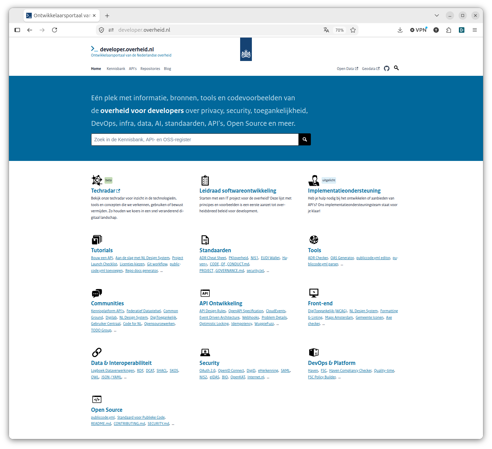
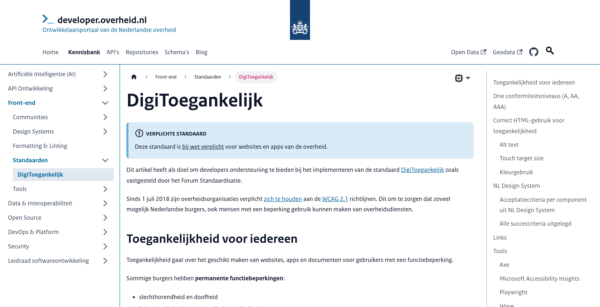
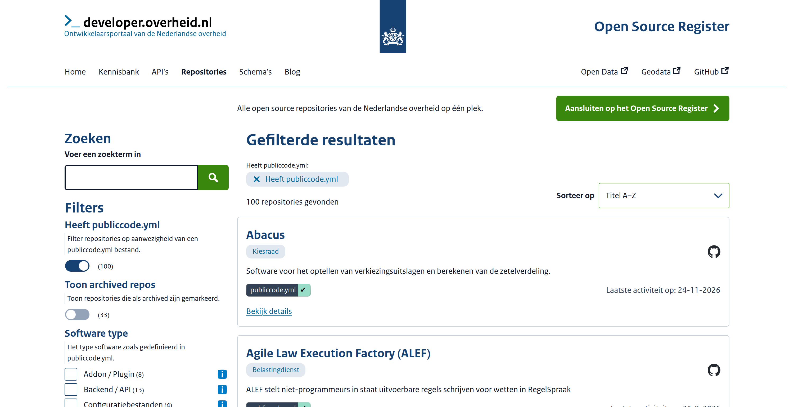
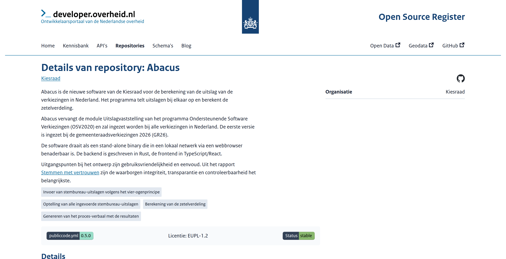
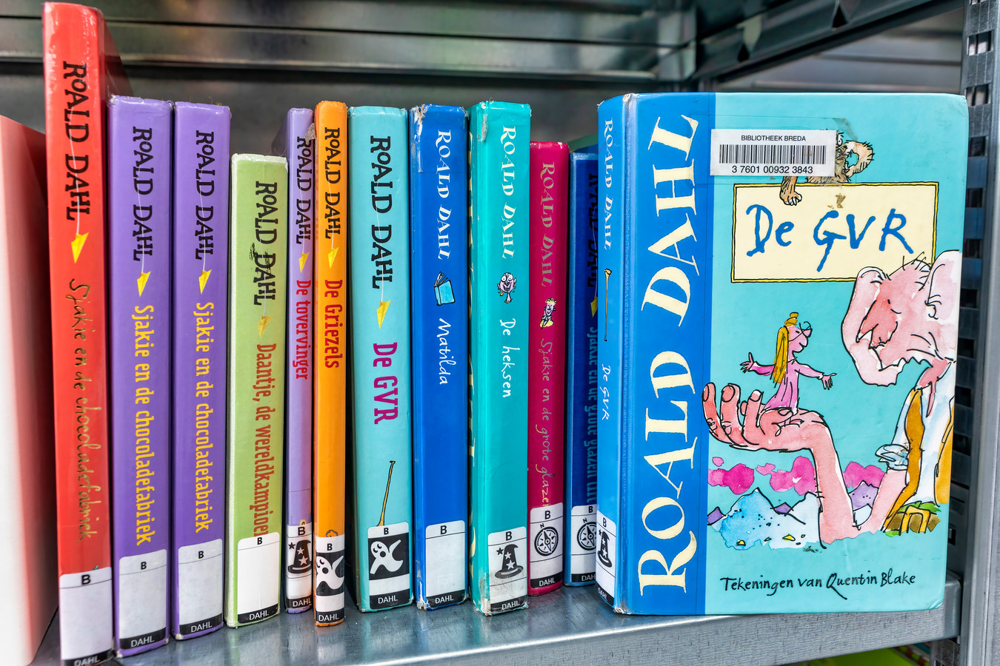
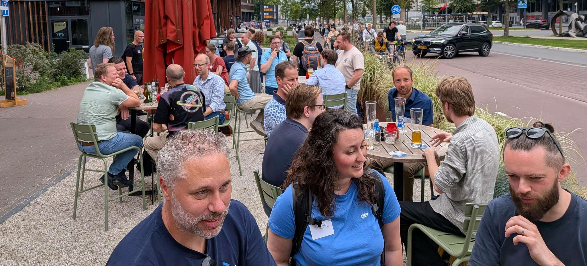

# Kennissessie innovatiebudget

<!-- 
En waarom we veel meer moeten investeren in developertooling voor standaarden
 -->

<!-- _class: title invert -->

<ul class="horizontal-list" style="margin-top: 3rem;">
  <li>Tom Ootes</li>
  <li>🐘 <a href="https://social.codefor.nl/@tomootes">@tomootes</a></li>
  <li>Amsterdam</li>
  <li>26 november 2026</li>
</ul>

## Agenda

<!-- _class: invert -->

1. Over developer.overheid.nl
1. Ons doel: opgedane kennis opschrijven
1. Project beschrijven met publiccode.yml
1. Licenties
1. Praktisch, wat niet publiceren
1. Open Source Skill
1. Oproep, geef ons feedback

## developer.overheid.nl

<!-- _class: invert -->

## Kennisbank

<!-- _class: invert screenshot-full -->

<!--

Volledig open source op allerlei thema's
Opgedeeld in standaarden/ tools/ tutorials

-->

## Open Source Catalogus

<!-- _class: invert screenshot-full -->

<!--

Metadata op basis van publiccode.yml

-->

## Open Source Catalogus

<!-- _class: invert screenshot-full -->

## 🪄 publiccode.yml

  <ul>
    <li>Metadata-standaard (voorbeeld bibliotheek)</li>
    <li>Fungeert als flag</li>
    <li>Maakt doorzoekbaar</li>
    <li>In 2018 ontstaan (@bvh), veel gebruikt in Italië</li>
    <li>Eén bestandje in je project</li>
    <li>Makkelijk migreren van git-platform</li>
    <li>Gebruikt door catalogi in 🇮🇹🇫🇷🇩🇪🇳🇱🇪🇺</li>
  </ul>
  

    
  

<!--

Dit is de bron van de Open Source Catalogus die je net zag.
Het bestand werkt als een vlag: "dit is overheidssoftware, en je mag het hergebruiken".
Het is machineleesbaar, dus catalogi kunnen het automatisch oppikken.

-->

## Hoe ziet dat eruit?

<!-- _class: invert browser -->

<i></i><i></i><i></i>

github.com/kiesraad/abacus/blob/main/publiccode.yml

kiesraad / abacus / <b>publiccode.yml</b>87 lines · YAML

<b><i class="k">publiccodeYmlVersion</i>: <i class="s">&quot;0.5.0&quot;</i></b><b></b><b><i class="k">name</i>: <i class="v">Abacus</i></b><b><i class="k">url</i>: <i class="s">&quot;https://github.com/kiesraad/abacus&quot;</i></b><b><i class="k">softwareType</i>: <i class="v">standalone/web</i></b><b><i class="k">developmentStatus</i>: <i class="v">stable</i></b><b></b><b><i class="k">platforms</i>:</b><b>  <i class="o">- </i><i class="v">web</i></b><b></b><b><i class="k">categories</i>:</b><b>  <i class="o">- </i><i class="v">data-collection</i></b><b>  <i class="o">- </i><i class="v">data-analytics</i></b><b></b><b><i class="k">description</i>:</b><b>  <i class="k">nl</i>:</b><b>    <i class="k">documentation</i>: <i class="s">&quot;https://kiesraad.github.io/abacus-documentatie/&quot;</i></b><b>    <i class="k">shortDescription</i>: <i class="o">&gt;-</i></b><b><i class="t">      Software voor het optellen van verkiezingsuitslagen en berekenen van de zetelverdeling.</i></b><b>    <i class="k">longDescription</i>: <i class="o">|</i></b><b><i class="t">      Abacus is de nieuwe software van de Kiesraad voor de berekening van de</i></b><b><i class="t">      uitslag van de verkiezingen in Nederland. Het programma telt uitslagen</i></b><b><i class="t">      bij elkaar op en berekent de zetelverdeling.</i></b><b></b><b><i class="t">      Abacus vervangt de module Uitslagvaststelling van het programma</i></b><b><i class="t">      Ondersteunende Software Verkiezingen (OSV2020) en zal ingezet worden bij</i></b><b><i class="t">      alle verkiezingen in Nederland. De eerste versie is ingezet bij de</i></b><b><i class="t">      gemeenteraadsverkiezingen 2026 (GR26).</i></b><b></b><b><i class="t">      De software draait als een stand-alone binary die in een lokaal netwerk</i></b><b><i class="t">      via een webbrowser benaderbaar is. De backend is geschreven in Rust, de</i></b><b><i class="t">      frontend in TypeScript/React.</i></b><b></b><b><i class="t">      Uitgangspunten bij het ontwerp zijn gebruiksvriendelijkheid en eenvoud.</i></b><b><i class="t">      Uit het rapport [Stemmen met vertrouwen](https://www.kiesraad.nl/documenten/2007/09/27/eindrapport-commissie-korthals-altes-stemmen-met-vertrouwen) zijn de waarborgen integriteit, transparantie en</i></b><b><i class="t">      controleerbaarheid het belangrijkste.</i></b><b>    <i class="k">features</i>:</b><b>      <i class="o">- </i><i class="v">Invoer van stembureau-uitslagen volgens het vier-ogenprincipe</i></b><b>      <i class="o">- </i><i class="v">Optelling van alle ingevoerde stembureau-uitslagen</i></b><b>      <i class="o">- </i><i class="v">Berekening van de zetelverdeling</i></b><b>      <i class="o">- </i><i class="v">Genereren van het proces-verbaal met de resultaten</i></b><b>  <i class="k">en</i>:</b><b>    <i class="k">shortDescription</i>: <i class="o">&gt;-</i></b><b><i class="t">      Software for tallying election results and calculating seat allocation.</i></b><b>    <i class="k">longDescription</i>: <i class="o">|</i></b><b><i class="t">      Abacus is the new software developed by the Dutch Electoral Council</i></b><b><i class="t">      (Kiesraad) for calculating election results in the Netherlands. It tallies</i></b><b><i class="t">      polling station results and computes the seat allocation.</i></b><b></b><b><i class="t">      Abacus replaces the result-consolidation module of the current election</i></b><b><i class="t">      software OSV2020 and will be used for all Dutch elections. The first</i></b><b><i class="t">      version targets the 2026 municipal council elections (GR26).</i></b><b></b><b><i class="t">      The software runs as a standalone binary accessible via a web browser on a</i></b><b><i class="t">      local network. The backend is written in Rust, the frontend in</i></b><b><i class="t">      TypeScript/React.</i></b><b></b><b><i class="t">      Key design principles are ease-of-use and simplicity.</i></b><b><i class="t">      From the (dutch) report [Stemmen met vertrouwen](https://www.kiesraad.nl/documenten/2007/09/27/eindrapport-commissie-korthals-altes-stemmen-met-vertrouwen) the</i></b><b><i class="t">      values integrity, transparency and verifiability are most important.</i></b><b>    <i class="k">features</i>:</b><b>      <i class="o">- </i><i class="v">Entry of polling station results using the four-eyes principle</i></b><b>      <i class="o">- </i><i class="v">Aggregation of all entered polling station results</i></b><b>      <i class="o">- </i><i class="v">Calculation of seat allocation</i></b><b>      <i class="o">- </i><i class="v">Generation of the official record (proces-verbaal) with results</i></b><b></b><b><i class="k">legal</i>:</b><b>  <i class="k">license</i>: <i class="v">EUPL-1.2</i></b><b>  <i class="k">mainCopyrightOwner</i>: <i class="v">Kiesraad</i></b><b></b><b><i class="k">intendedAudience</i>:</b><b>  <i class="k">countries</i>:</b><b>    <i class="o">- </i><i class="v">NL</i></b><b>  <i class="k">scope</i>:</b><b>    <i class="o">- </i><i class="v">government</i></b><b></b><b><i class="k">localisation</i>:</b><b>  <i class="k">localisationReady</i>: <i class="v">true</i></b><b>  <i class="k">availableLanguages</i>:</b><b>    <i class="o">- </i><i class="v">nl</i></b><b></b><b><i class="k">maintenance</i>:</b><b>  <i class="k">type</i>: <i class="v">internal</i></b><b>  <i class="k">contacts</i>:</b><b>    <i class=o>- </i><i class="k">name</i>: <i class="v">Kiesraad</i></b><b>      <i class="k">email</i>: <i class="v">abacus@kiesraad.nl</i></b><b>      <i class="k">affiliation</i>: <i class="v">Kiesraad</i></b>

## Repository open source skill

<!-- _class: invert -->

  <ul>
    <li>Genereert README, LICENSE, SECURITY, CONTRIBUTING én <code>publiccode.yml</code></li>
    <li>Web-formulier, CLI en Agent Skill</li>
    <li>Eén set templates en validatie</li>
    <li>Skill leest je project uit en draait de CLI</li>
  </ul>
  

<pre class="terminal">tom:~/mijn-project$ claude plugin marketplace add \
    developer-overheid-nl/skills-marketplace
tom:~/mijn-project$ claude plugin install \
    developer-overheid-open-source-repo@overheid-plugins
✔ Installed developer-overheid-open-source-repo

tom:~/mijn-project$ claude
❯ maak dit project open source

● Skill(open-source-repo)
● Created README.md, LICENSE, SECURITY.md,
  CONTRIBUTING.md, CHANGELOG.md, publiccode.yml

# of zonder AI-assistent:
tom:~/mijn-project$ npx \
    github:developer-overheid-nl/repo-docs-generator --init</pre>

  

<!--

github.com/developer-overheid-nl/repo-docs-generator
Alles wat we in de kennisbank over open source opschrijven, zit ook in deze tool.
Web-UI: developer-overheid-nl.github.io/repo-docs-generator, formulier invullen en downloaden.
CLI: voor ontwikkelaars en CI-pipelines, input.json gevalideerd tegen een JSON Schema.
Skill: "maak dit project open source" in Claude Code of Cursor, en de assistent doet de rest.
Eén set templates: verbeter je een template, dan geldt het voor alle drie.

-->

## Vraag aan jullie!

- Klop bij ons aan
- Voeg een **`publiccode.yml`** toe aan jullie open source repo's
- Probeer onze tooling, geef feedback
- Gastblogs/ artikelen
- Issues/ PR's
- Op termijn: schema's aanleveren?

## Events!

  
  Meld je aan!

<!-- Zet 15 december in je agenda -->

## Bedankt!

Vragen?

🐘 [social.codefor.nl/@tomootes](https://social.codefor.nl/@tomootes) 📬 t.ootes@geonovum.nl
