<!-- _paginate: false -->

# Open Source als kans voor de veiligheidsregio's

<!-- _class:  invert  -->

<ul class="horizontal-list">
  <li>Tom Ootes & Jan Klopper</li>
  <li>tom@ootes.io</li>
  <li>Veiligheidsregio Drenthe</li>
  <li>19 november 2026</li>
</ul>

<!--

- Leuk dat ik hier mag vertellen over DON
- Grapje dat ik hier aan de overkant van het kanaal woon
- Vertellen over alle inzichten van DON afgelopen jaren
- Mooie tools die hieruit voort zijn gekomen

De afgelopen jaren ben ik standaarden gaan zien als een manier van samenwerken,
van afspraken die je maakt als je bijvoorbeeld een API bouwt of een front-end.
Ik zie het als een manier voor onze overheid om eindelijk wat meer eenduidig te
developen, maar ook als een manier om instructies mee te geven aan LLM's zodat
coding agents niet uit de bocht vliegen. In die zin worden standaarden steeds
belangrijker.

-->

## Over Tom

<!-- _class: invert -->

  <ul>
    <li>Tom Ootes</li>
    <li>Developer.overheid.nl (2023)</li>
    <li>Open Source, Developer Advocate</li>
    <li>Community, outreach</li>
    <li>Muzikant/ muziekliefhebber</li>
  </ul>
  

    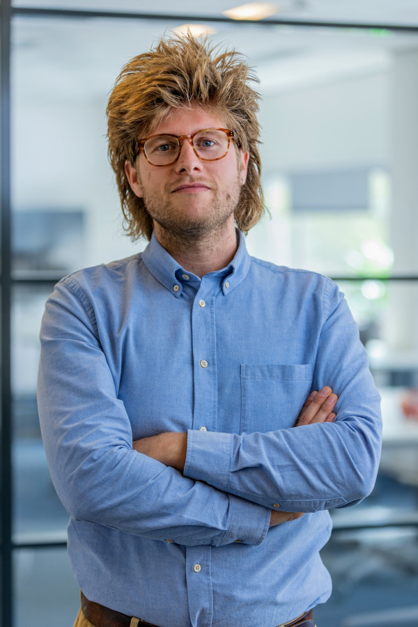
  

<!--
Kort eerst iets over mijzelf.

Ik ben Tom, werk al sinds 2023 aan developer.overheid.nl. Als freelancer
veel verschillende overheidsprojecten gedaan. Vind het mooi om daaraan te
werken omdat we met developer.overheid.nl een gemeenschappelijk platform
hebben om developers op eenduidige manier software te laten bouwen.

Mijn rol is developer advocate wat betekent dat ik me verdiep in wat developers
nodig hebben om bijvoorbeeld compliant te kunnen worden aan een standaard.

-->

## Over Jan

<!-- _class: invert -->

  <ul>
    <li>Jan Klopper</li>
    <li>Developer.overheid.nl (2025)</li>
    <li>OpenKAT architect en maintainer.</li>
    <li>Security, Internet standaarden.</li>
  </ul>
  

    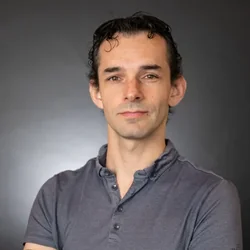
  

<!--
Kort eerst iets over mijzelf.

Zo'n 25 jaar 'in het vak', en daar in alles gezien van hardware, netwerken
tot css en alles er tussen. De laatste paar jaar vooral in Crisis-ict rollen.
Architect en maintainer van OpenKAT bij MinVWS, daarna developer overheid in
de rol Implementatieadviseur internet standaarden, met een voorkeur voor 
security.
-->

## Agenda

<!-- _class: invert -->

1. Kort: developer.overheid.nl
2. Wat is open source?
3. Waarom nu: actualiteit, EU-strategie & digitale soevereiniteit
4. Digital Commons & andere redenen om open te werken
5. Hoe begin je: inkoop van producten (Nextcloud) en ontwikkeling
6. Software bouwen met AI: kansen, valkuilen & skills

##

<!-- _class: page-image-only -->
<!-- _header: "" -->
<!-- _footer: "" -->
<!-- _paginate: false -->

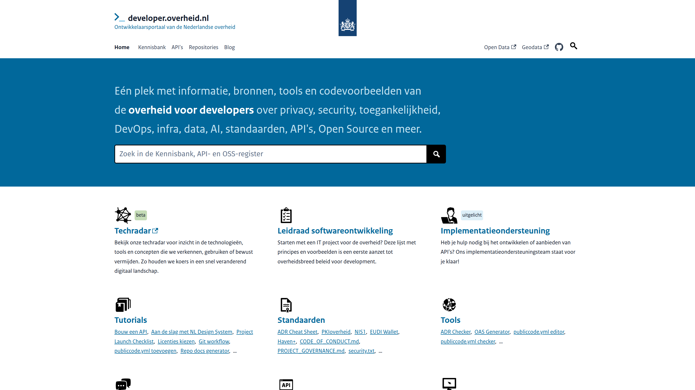

## Open Source

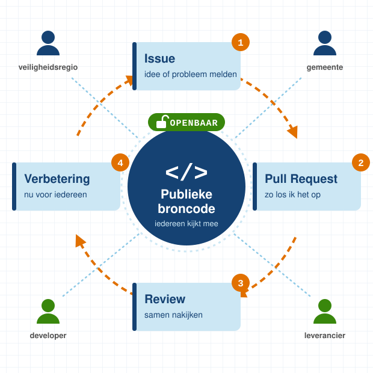

- De broncode is beschikbaar
- Iedereen kan bijdragen/ voorstellen doen
- Verzoeken doen tot wijzigingen van de code
- Investeringen komen terug bij alle stakeholders
- Gedeeld eigenaarschap

## Huidige ontwikkelingen

<!-- _class: invert -->

  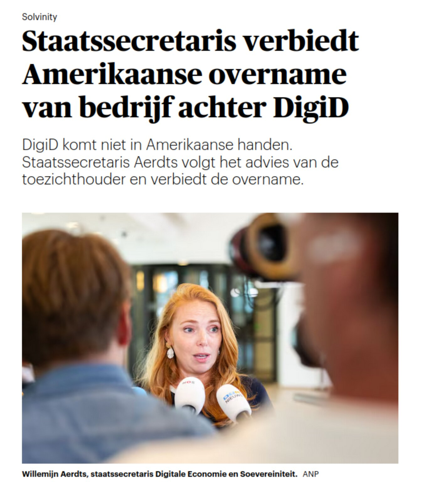
  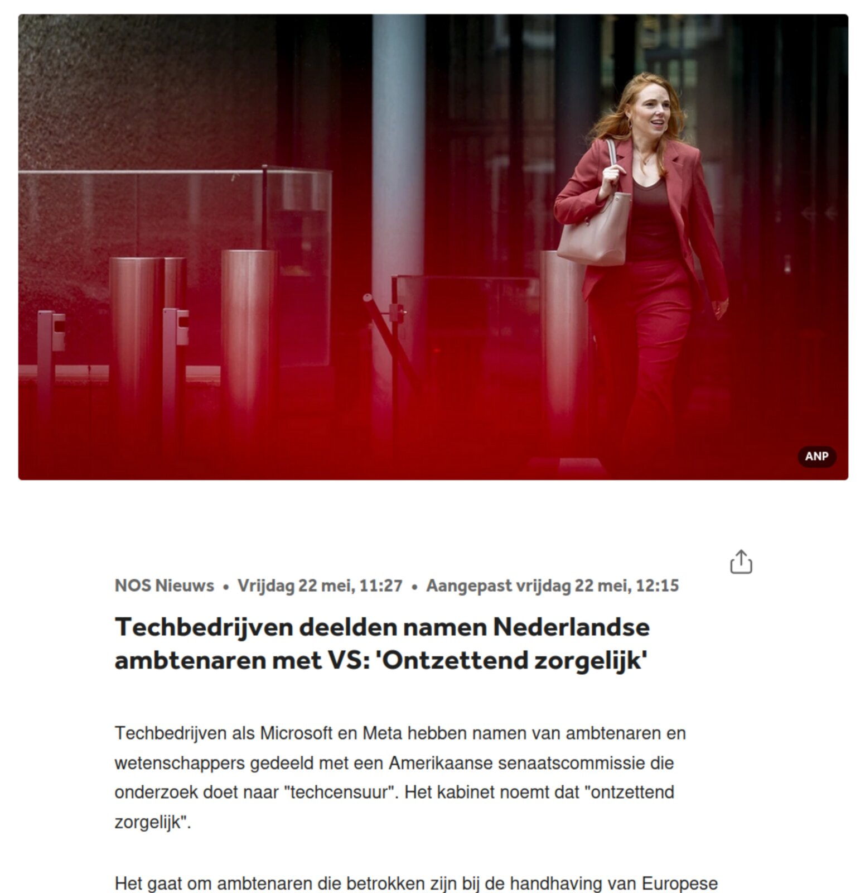

## EU: Open Source Strategy (3 juni)

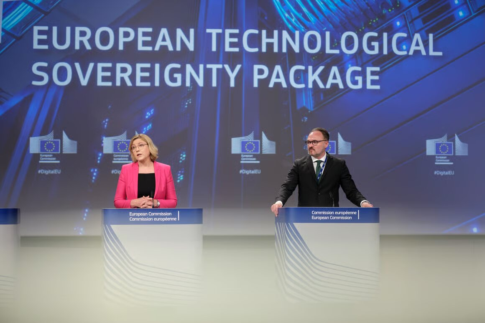

- 2 miljard verdeeld over 7 jaar
- Investeringen in
  - Kritische open source projecten
  - Open Source startups
  - Kennisontwikkeling

## Als route naar digitale soevereiniteit

- Zelf leverancier kiezen
- Slim in grillige geopolitieke context
- Ook grote bedrijven steeds min stabiel (Office 365)

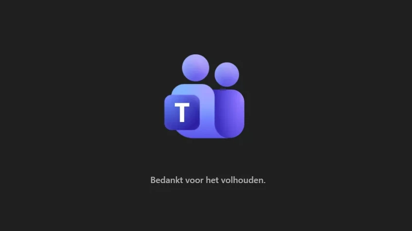

## Proprietary: wat was ook alweer het probleem?

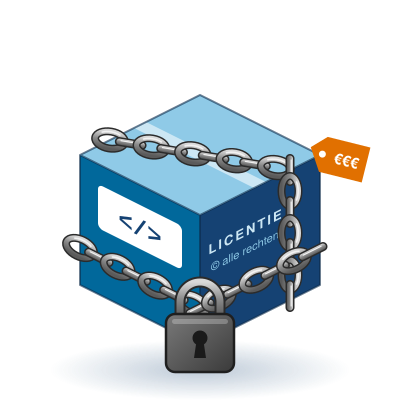

<!-- _class: list-text-small -->

- Vendor lock-in
- Prijsstijgingen
- Geen invloed roadmap
- Geen code-portabiliteit
- Black-box (security, ook downstream)
- Diplomatiek (chantabel)
- Cloud act (data)

## Open source: hoe lost het dit op?

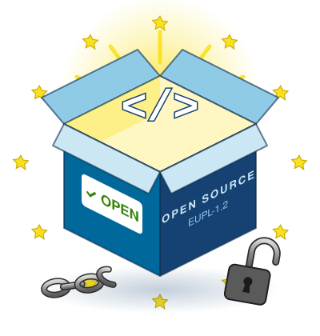

<!-- _class: list-text-small -->

- Vrij om zelf keuzes te maken
- Open source product = meerdere leveranciers
- Zelf bijdragen levert voor iedereen winst op
- Communities kunnen de code kopiëren zelf verdergaan
- Zelf hosten of bij leverancier
- In Europa

## “Digital Commons”

- Vertaal als “Meente” van “Gemeente”
  - Een gemeenschappelijk stuk grond
- Metafoor van een bos
  - Onderhouden door de gemeenschap
  - Iedereen kan er gebruik van maken
- Voorbeelden: Wikipedia, PostgreSQL, Linux
- Geld blijft in Europa

## Vibe coden is als Eucalyptus planten

## Andere redenen open sourcen:

- WOO verplicht openbaren code
- Open, tenzij
- Public Money, Public Code

## Hoe te beginnen?

- Begin met afnemen van Open Source producten
- Begin ook met bijdragen aan bestaande projecten (QGIS)
- [https://oss.developer.overheid.nl](https://oss.developer.overheid.nl)

## Open Source inkoop; voorbeeld Nextcloud

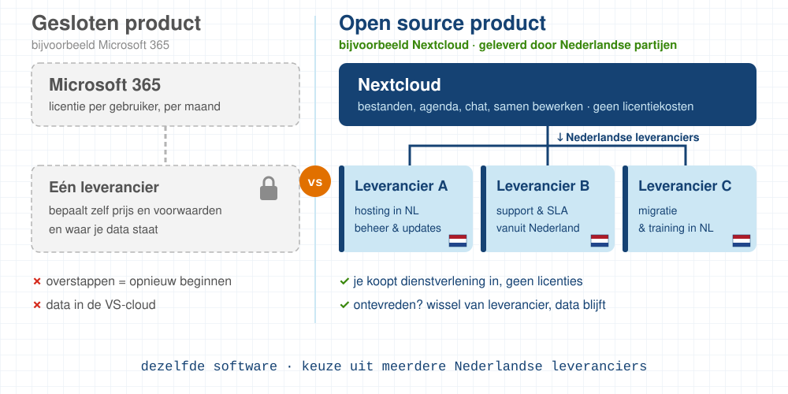

<!--
Voorbeeld Nextcloud als alternatief voor Microsoft 365: bestanden, agenda, chat/videobellen, samen bewerken.
Bij open source koop je geen licenties, maar dienstverlening: hosting, beheer, support, migratie.
Dezelfde software wordt door meerdere (Nederlandse) partijen aangeboden. Ontevreden? Wissel van leverancier, je data en software blijven.
Sluit aan op digitale soevereiniteit (eerdere slide).
-->

## Open Source, inkoop software ontwikkeling

- Bij offreren Open Source opgeven als eis
- Trekt vaak juist innovatieve partijen aan met lef, die trots zijn op hun code

## Waar helpt AI ons bij?

- Makkelijk wensen omzetten in software
- Snel leveren aan de praktijk
- Doorvragen; makkelijk leren van AI (als je wilt)
- Onafhankelijk worden van leveranciers door zelf bouwen

## Valkuilen

<!-- _class: invert -->

- Zonder instructies kiest AI zelf
- Je bouwt iets wat je niet kan onderhouden / niet begrijpt
- Gevoelige gegevens, persoonsgegevens of interne documenten
- AI zet makkelijk wachtwoorden of API-sleutels in de code
- Werkt in de demo, niet in productie
- Iedereen bouwt zijn eigen eilandje, er ontstaat wildgroei
- Wie is de eigenaar? Vanaf het begin intern bijhouden

## Wat AI niet vervangt

- Gebruikersonderzoek > UX-research > gewoon interviews afnemen
- Goede technische standaarden/ best practices
- Community building > andere veiligheidsregio's uitnodigen
- Kritisch nadenken en keuzes maken > nog steeds developers nodig (als architect)

## Advies

- Zet in op samen ontwikkelen/ community building
- Bouw aan de relaties
- Koop open source producten en support in
- Huur software-partijen in voor open ontwikkeling
- Draag kosten gezamenlijk als regio's

## Bedankt!

<!-- _class: invert grid-paper -->

Vragen?

<!-- prettier-ignore -->
- Slides op [github.io](https://developer-overheid-nl.github.io/slideshows/shows/veiligheidsregio-drenthe)
- 📬 tom@ootes.io

  
  
<strong>Schrijf je in voor onze meetup!</strong> Locatie: Utrecht

<!--

Scan de QR-code om je in te schrijven voor de developer.overheid.nl meetup: https://opensourcewerken.nl/events/view/8dfe1365-3742-4832-8359-f2efed31126a/developeroverheidnl-meetup-samenbeterbouwen

-->
