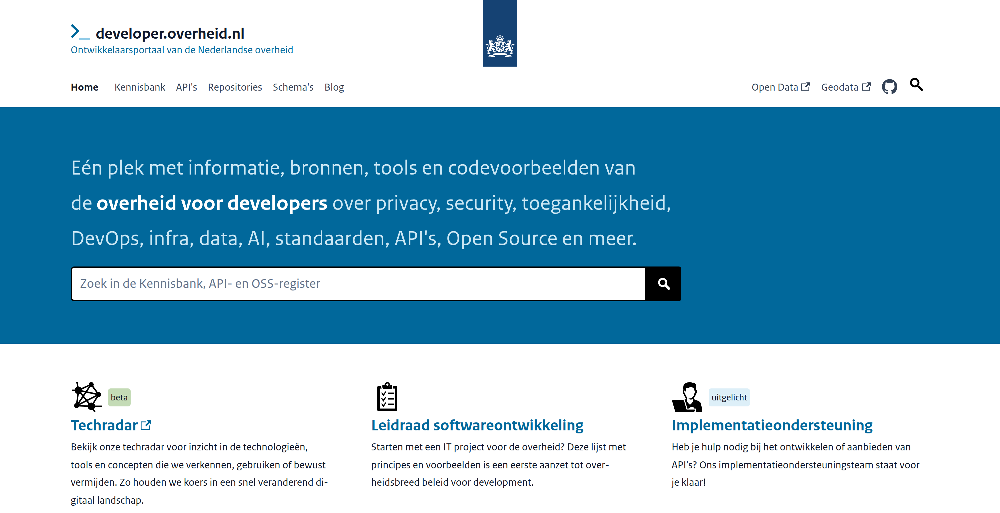

# > Open source jouw repository!

<!-- _class: title invert title-terminal -->

<!-- <p style="text-align: center; max-width: 60%; margin: 0 auto;">En waarom we veel meer moeten investeren in developertooling voor standaarden</p> -->

<ul class="horizontal-list" style="margin-top: 3rem;">
  <li>Tom Ootes</li>
  <li>🐘 <a href="https://social.codefor.nl/@tomootes">@tomootes</a></li>
  <li>Amersfoort</li>
  <li>1 december 2026</li>
</ul>

## whoami?

<!-- _class: invert -->

<div class="two-columns">
  <ul>
    <li>Tom Ootes</li>
    <li>Developer.overheid.nl (2023)</li>
    <li>Open Source, Developer Advocate</li>
    <li>Community, outreach</li>
  </ul>
  <div>
    
  </div>
</div>

<!--
Kort eerst iets over mijzelf.

Ik ben Tom, werk al sinds 2023 aan developer.overheid.nl. Als freelancer
veel verschillende overheidsprojecten gedaan. Vind het mooi om daar aan te
werken omdat we met developer.overheid.nl een gemeenschappelijk platform
hebben om developers op een-duidige manier software te laten bouwen.

Mijn rol is developer advocate wat betekent dat ik me verdiep in wat developers
nodig hebben om bijvoorbeeld compliant te kunnen worden aan een standaard.

-->

## Kennismaken: wie zijn jullie?

Laten we een rondje doen

<!-- _class:  grid-paper -->

## Agenda

<!-- _class: invert list-text-small -->

1. Kennismaken en developer.overheid.nl
1. Waarom open source?
1. Drie oefeningen: jij en je project
1. Pauze ☕
1. Aan de slag: generator, licentie en REUSE
1. Samen invullen: `publiccode.yml` en community files
1. Recap en vragen

## COVID-19: front-end dev VWS

<!-- _class: invert title-left -->

- Ministerie van Volksgezondheid, Welzijn en Sport
- Bron- en contactonderzoek
- Vragenlijsten en formulieren
- Informeren/ statistieken


<!--
Voordat ik bij developer.overheid.nl begon, werkte ik als freelancer bij VWS.
Midden in de coronacrisis: software voor het bron- en contactonderzoek,
vragenlijsten en formulieren, en het informeren van burgers met statistieken.
-->

## Hoe het eraan toe ging

<!-- _class: title-left invert -->

- Veel beleidswijzigingen
- Inhouse was iets nieuws
- Elk team zijn eigen stack
- 📖 Geen interne docs


<!--

Nou waar we toen mee te maken hadden waren veel beleidswijzigingen. Het kon zijn dat als we maandagochtend onze werkdag begonnen dat er dan allerlei parameters zoals bijvoorbeeld de quarantaineperiode gewijzigd moesten worden. Wij moesten dat dan zo snel mogelijk doorvoeren, dit had trouwens allerlei effecten op hoe de front-end werkte, dus dat moest getest worden, en dan moest het naar productie.

Nog een ding, voor het VWS was het dus iets nieuws om zelf software te bouwen. Dus de organisatie moest er heel erg aan wennen.

Ja, het voelde als developer dus gek om in die context ook te bouwen, omdat er niks vastgelegd was.

-->

## Waarom is er niks centraals?

<!-- _class: title-left invert -->


## developer.overheid.nl

<a class="window" href="https://developer.overheid.nl" data-url="developer.overheid.nl"></a>

<!-- _class: invert screenshot-full -->

## Waarom open source?

- Innovatie, samenwerken
- Leren van anderen
- Niet het wiel opnieuw uitvinden
- Economisch, geld besparen
- Transparantie
  - Wetten > worden die nageleefd?
  - Algoritmes, sluiten die geen mensen uit?
  - Code; is die veilig?
- Vinden van stakeholders > andere organisaties

## Community opbouwen

- Dit is eigenlijk een functie opzich
- Kost veel tijd maar ook resources, draagvlak!

## Oefening 1: Waarom wil je dit project open sourcen?

<!-- _class: timer -->

Oefening, schrijf op:

- Waarom wil ik dit project zelf open sourcen?
- Waarom is het nuttig voor jouw organisatie?
- Probeer een paar doelen op te schrijven

<button class="countdown" data-minutes="2">02:00</button>

<!-- 2 minuten: iedereen schrijft voor zichzelf een paar doelen op. -->

## Oefening 2: Welke doelen heb je met dit project?

<!-- _class: timer -->

Oefening, schrijf op:

- Wat moet het project bereiken door open source te zijn?
- Hergebruik door andere organisaties? Bijdragen van buitenaf? Transparantie?
- Wanneer is het voor jou geslaagd?

<button class="countdown" data-minutes="2">02:00</button>

<!-- 2 minuten: van persoonlijke motieven naar doelen voor het project zelf. -->

## Oefening 3: Wie zijn mijn stakeholders/ doelgroepen?

<!-- _class: timer -->

- Verplaats je in je stakeholders, wie zijn dat?
- Welke use cases kunnen die hebben?
- Wat voor soort organisaties?
- Wat hebben die nodig?

<button class="countdown" data-minutes="3">03:00</button>

## Pauze!

<!-- _class: grid-paper -->

☕

## Aan de slag!

```bash
git --version
node --version   # v18 of hoger
python3 --version   # op Windows: py --version
pipx --version
reuse --version
```

<!-- _class: invert code-terminal  -->

## Repo docs generator draaien

<!-- _class: invert code-terminal title-top -->

<pre class="terminal" style="--code-terminal-title: 'tom@developer.overheid.nl: ~/mijn-project'"><span class="dim"># 1. Maak een voorbeeld input.json aan</span>
<span class="user">tom@developer.overheid.nl</span>:<span class="path">~/mijn-project</span>$ npx github:developer-overheid-nl/repo-docs-generator <span class="rule">--init</span>
<span class="ok">✓</span> Example input.json written

<span class="dim"># 2. Vul naam, organisatie, licentie en contact in</span>
<span class="user">tom@developer.overheid.nl</span>:<span class="path">~/mijn-project</span>$ code input.json

<span class="dim"># 3. Genereer de bestanden in ./generated</span>
<span class="user">tom@developer.overheid.nl</span>:<span class="path">~/mijn-project</span>$ npx github:developer-overheid-nl/repo-docs-generator <span class="rule">input.json -o ./generated</span>
<span class="ok">✓ Done. Generated 7 document(s) in ./generated</span></pre>

[https://github.com/developer-overheid-nl/repo-docs-generator](https://github.com/developer-overheid-nl/repo-docs-generator)

<!--
Drie stappen, alleen Node >= 18 nodig, niks clonen:
1. --init schrijft een voorbeeld input.json weg.
2. input.json invullen: naam, organisatie, licentie, contactgegevens.
   De input wordt gevalideerd tegen een JSON Schema, je krijgt dus meteen te zien wat mist.
3. Genereren naar ./generated (zonder -o wordt het ./output). Niet direct -o . gebruiken:
   dat overschrijft een bestaande README. Bekijk de bestanden en kopieer wat je wilt houden.
   Alleen een paar bestanden? -t README.md -t SECURITY.md

Geen Node? Web-formulier: developer-overheid-nl.github.io/repo-docs-generator
-->

## Een licentie kiezen

<!-- _class: invert list-text-small -->

|                           | Permissief          | Copyleft                       |
| ------------------------- | ------------------- | ------------------------------ |
| Voorbeelden               | MIT, Apache-2.0     | EUPL-1.2, GPL-3.0, AGPL-3.0    |
| Mag in gesloten software? | Ja                  | Nee, aanpassingen blijven open |
| Past bij                  | Libraries, snippets | Applicaties, overheidsdiensten |

- Geen licentie = alle rechten voorbehouden: niemand mag het hergebruiken
- Check je dependencies: die bepalen wat mag
- Overheid? Begin bij **EUPL-1.2**

<!--
Zonder licentie is je code niet open source: auteursrecht betekent dan "alles voorbehouden".
Kies altijd een bestaande, door OSI goedgekeurde licentie; schrijf nooit zelf een licentie.

- Permissief (MIT, Apache-2.0): iedereen mag alles, ook in gesloten software verwerken.
  Fijn voor libraries die je zo breed mogelijk gebruikt wilt zien. Apache-2.0 regelt ook patenten.
- Copyleft (EUPL, GPL, AGPL): aanpassingen die je verspreidt moeten onder dezelfde licentie open blijven.
  Zo voorkom je dat een leverancier jouw code gesloten doorverkoopt.
- Dependencies: gebruik je GPL-code, dan moet je project GPL-compatibel zijn.
- Overheid: "Open, tenzij", met EUPL-1.2 als logische standaardkeuze (volgende slide).

Handig: choosealicense.com en de EUPL-compatibiliteitschecker op interoperable-europe.ec.europa.eu.
-->

## EUPL-1.2

<!-- _class: invert list-text-small -->

- Ontwikkeld door de EC
  - Je kunt hier ook terecht voor juridische vragen
  - Volwassen licentie
- Juridisch sterk
- Voor overheden
- Copyleft
  - Iedereen mag de code gebruiken, aanpassen en delen
  - Maar aanpassingen die je verspreidt, blijven ook open (onder dezelfde licentie)
  - Ook als je de software alleen als online dienst aanbiedt


<div class="credit">

[EUPL-logo][eupl-logo] door MarcBresson · [CC BY-SA 4.0][cc-by-sa]

</div>

[eupl-logo]: https://commons.wikimedia.org/wiki/File:Logo_EUPL.svg
[cc-by-sa]: https://creativecommons.org/licenses/by-sa/4.0/

<!--
De European Union Public Licence, versie 1.2: de licentie die de Europese Commissie zelf
voor overheidssoftware heeft gemaakt. In Nederland de voorkeurslicentie bij "Open, tenzij".


- Copyleft: wie een aangepaste versie verspreidt, moet die ook onder EUPL openbaar maken.
  Anders dan de GPL geldt dat ook als je de software alleen als dienst via het netwerk aanbiedt.
  Dankzij de compatibiliteitsclausule mag je combineren met o.a. GPL, AGPL, LGPL, MPL en EPL.
- Juridisch sterk: geschreven voor Europees recht, met afspraken over toepasselijk recht
  en rechter. Officieel in alle 23 EU-talen, elke versie is even geldig (dus ook in het Nederlands).
- Voor overheden: gemaakt door en voor publieke organisaties, breed gebruikt in Europa.

In REUSE: SPDX-identifier EUPL-1.2, de tekst komt in LICENSES/EUPL-1.2.txt (zie de volgende slides).
Bron: interoperable-europe.ec.europa.eu/collection/eupl
-->

## REUSE: welke licentie geldt waarvoor?

<!-- _class: invert list-text-small -->

  <ul>
    <li>Eén <code>LICENSE</code> zegt vaak te weinig: fonts en afbeeldingen hebben vaak een andere licentie</li>
    <li>REUSE (FSFE) legt copyright en licentie per bestand of map vast</li>
    <li>In <code>REUSE.toml</code>: eerst de hele repo (<code>**</code>), daarna de uitzonderingen</li>
    <li><code>reuse lint</code> controleert het, ook in je CI</li>
    <li>Voorbeeld op onze kennisbank: Kennisbank > Open Source > Standaarden > REUSE</li>
  </ul>
  
<!--
Het LICENSE-bestand in de root zegt vaak weinig over alles wat er in een project zit:
fonts, afbeeldingen, gekopieerde libraries hebben vaak een heel andere licentie.
Met REUSE leg je per map/path vast welke licentie en welk copyright geldt.

Ons eigen voorbeeld (de REUSE.toml van developer.overheid.nl) staat op de kennisbank:
Kennisbank > Open Source > Standaarden > REUSE
developer.overheid.nl/kennisbank/open-source/standaarden/reuse
Daar staan ook de commando's (reuse lint, reuse download --all) en CI-voorbeelden
voor GitHub, GitLab en Forgejo.
-->

## REUSE checken en repareren

<!-- _class: invert code-terminal title-top -->

<pre class="terminal" style="--code-terminal-title: 'tom@developer.overheid.nl: ~/mijn-project'"><span class="user">tom@developer.overheid.nl</span>:<span class="path">~/mijn-project</span>$ reuse lint   <span class="dim"># controleer of het project aan REUSE voldoet</span>
<span class="rule"># MISSING LICENSES</span>

'EUPL-1.2' found in:
* REUSE.toml

<span class="rule"># SUMMARY</span>

* Missing licenses: <span class="err">EUPL-1.2</span>
* Used licenses: EUPL-1.2
* Files with license information: 42 / 42
<span class="dim">…</span>

<span class="err">Unfortunately, your project is not compliant with version 3.3 of the REUSE Specification :-(</span>

<span class="user">tom@developer.overheid.nl</span>:<span class="path">~/mijn-project</span>$ reuse download --all   <span class="dim"># zet ontbrekende licentieteksten in LICENSES/</span>
<span class="ok">Successfully downloaded LICENSES/EUPL-1.2.txt.</span>

<span class="user">tom@developer.overheid.nl</span>:<span class="path">~/mijn-project</span>$ reuse lint
<span class="ok">Congratulations! Your project is compliant with version 3.3 of the REUSE Specification :-)</span></pre>

<!--
Twee commando's die je nodig hebt:
- reuse lint: controleert of elk bestand copyright- en licentie-informatie heeft
  (via REUSE.toml of een header in het bestand) en of de licentieteksten aanwezig zijn.
- reuse download --all: haalt alle licenties die je gebruikt maar nog niet in LICENSES/ staan op.

Daarna opnieuw reuse lint: compliant. Zet reuse lint ook in je CI, voorbeelden voor GitHub, GitLab
en Forgejo staan op de kennisbank: Kennisbank > Open Source > Standaarden > REUSE.
-->

## publiccode.yml

<div class="two-columns">
  <ul>
    <li>Metadata-standaard (voorbeeld bibliotheek)</li>
    <li>Fungeert als flag 🚩</li>
    <li>Maakt doorzoekbaar</li>
    <li>In 2018 ontstaan, veel gebruikt in Italië</li>
    <li>Eén bestandje in je project</li>
    <li>Makkelijk migreren van git-platform</li>
    <li>Gebruikt door catalogi in 🇮🇹🇫🇷🇩🇪🇳🇱🇪🇺</li>
  </ul>
  <div>
    
  </div>
</div>

<!--

Dit is de bron van de Open Source Catalogus die je net zag.
Het bestand werkt als een vlag: "dit is overheidssoftware, en je mag het hergebruiken".
Het is machineleesbaar, dus catalogi kunnen het automatisch oppikken.

-->

## Hoe ziet dat eruit?

<!-- _class: invert browser -->

<div class="gh">
<div class="gh-bar"><div class="gh-dots"><i></i><i></i><i></i></div><div class="gh-url">github.com/kiesraad/abacus<span>/blob/main/publiccode.yml</span></div></div>
<div class="gh-fhead">kiesraad / abacus / <b>publiccode.yml</b><span>87 lines · YAML</span></div>
<div class="gh-code"><div class="gh-lines"><b><i class="k">publiccodeYmlVersion</i>: <i class="s">&quot;0.5.0&quot;</i></b><b></b><b><i class="k">name</i>: <i class="v">Abacus</i></b><b><i class="k">url</i>: <i class="s">&quot;https://github.com/kiesraad/abacus&quot;</i></b><b><i class="k">softwareType</i>: <i class="v">standalone/web</i></b><b><i class="k">developmentStatus</i>: <i class="v">stable</i></b><b></b><b><i class="k">platforms</i>:</b><b>  <i class="o">- </i><i class="v">web</i></b><b></b><b><i class="k">categories</i>:</b><b>  <i class="o">- </i><i class="v">data-collection</i></b><b>  <i class="o">- </i><i class="v">data-analytics</i></b><b></b><b><i class="k">description</i>:</b><b>  <i class="k">nl</i>:</b><b>    <i class="k">documentation</i>: <i class="s">&quot;https://kiesraad.github.io/abacus-documentatie/&quot;</i></b><b>    <i class="k">shortDescription</i>: <i class="o">&gt;-</i></b><b><i class="t">      Software voor het optellen van verkiezingsuitslagen en berekenen van de zetelverdeling.</i></b><b>    <i class="k">longDescription</i>: <i class="o">|</i></b><b><i class="t">      Abacus is de nieuwe software van de Kiesraad voor de berekening van de</i></b><b><i class="t">      uitslag van de verkiezingen in Nederland. Het programma telt uitslagen</i></b><b><i class="t">      bij elkaar op en berekent de zetelverdeling.</i></b><b></b><b><i class="t">      Abacus vervangt de module Uitslagvaststelling van het programma</i></b><b><i class="t">      Ondersteunende Software Verkiezingen (OSV2020) en zal ingezet worden bij</i></b><b><i class="t">      alle verkiezingen in Nederland. De eerste versie is ingezet bij de</i></b><b><i class="t">      gemeenteraadsverkiezingen 2026 (GR26).</i></b><b></b><b><i class="t">      De software draait als een stand-alone binary die in een lokaal netwerk</i></b><b><i class="t">      via een webbrowser benaderbaar is. De backend is geschreven in Rust, de</i></b><b><i class="t">      frontend in TypeScript/React.</i></b><b></b><b><i class="t">      Uitgangspunten bij het ontwerp zijn gebruiksvriendelijkheid en eenvoud.</i></b><b><i class="t">      Uit het rapport [Stemmen met vertrouwen](https://www.kiesraad.nl/documenten/2007/09/27/eindrapport-commissie-korthals-altes-stemmen-met-vertrouwen) zijn de waarborgen integriteit, transparantie en</i></b><b><i class="t">      controleerbaarheid het belangrijkste.</i></b><b>    <i class="k">features</i>:</b><b>      <i class="o">- </i><i class="v">Invoer van stembureau-uitslagen volgens het vier-ogenprincipe</i></b><b>      <i class="o">- </i><i class="v">Optelling van alle ingevoerde stembureau-uitslagen</i></b><b>      <i class="o">- </i><i class="v">Berekening van de zetelverdeling</i></b><b>      <i class="o">- </i><i class="v">Genereren van het proces-verbaal met de resultaten</i></b><b>  <i class="k">en</i>:</b><b>    <i class="k">shortDescription</i>: <i class="o">&gt;-</i></b><b><i class="t">      Software for tallying election results and calculating seat allocation.</i></b><b>    <i class="k">longDescription</i>: <i class="o">|</i></b><b><i class="t">      Abacus is the new software developed by the Dutch Electoral Council</i></b><b><i class="t">      (Kiesraad) for calculating election results in the Netherlands. It tallies</i></b><b><i class="t">      polling station results and computes the seat allocation.</i></b><b></b><b><i class="t">      Abacus replaces the result-consolidation module of the current election</i></b><b><i class="t">      software OSV2020 and will be used for all Dutch elections. The first</i></b><b><i class="t">      version targets the 2026 municipal council elections (GR26).</i></b><b></b><b><i class="t">      The software runs as a standalone binary accessible via a web browser on a</i></b><b><i class="t">      local network. The backend is written in Rust, the frontend in</i></b><b><i class="t">      TypeScript/React.</i></b><b></b><b><i class="t">      Key design principles are ease-of-use and simplicity.</i></b><b><i class="t">      From the (dutch) report [Stemmen met vertrouwen](https://www.kiesraad.nl/documenten/2007/09/27/eindrapport-commissie-korthals-altes-stemmen-met-vertrouwen) the</i></b><b><i class="t">      values integrity, transparency and verifiability are most important.</i></b><b>    <i class="k">features</i>:</b><b>      <i class="o">- </i><i class="v">Entry of polling station results using the four-eyes principle</i></b><b>      <i class="o">- </i><i class="v">Aggregation of all entered polling station results</i></b><b>      <i class="o">- </i><i class="v">Calculation of seat allocation</i></b><b>      <i class="o">- </i><i class="v">Generation of the official record (proces-verbaal) with results</i></b><b></b><b><i class="k">legal</i>:</b><b>  <i class="k">license</i>: <i class="v">EUPL-1.2</i></b><b>  <i class="k">mainCopyrightOwner</i>: <i class="v">Kiesraad</i></b><b></b><b><i class="k">intendedAudience</i>:</b><b>  <i class="k">countries</i>:</b><b>    <i class="o">- </i><i class="v">NL</i></b><b>  <i class="k">scope</i>:</b><b>    <i class="o">- </i><i class="v">government</i></b><b></b><b><i class="k">localisation</i>:</b><b>  <i class="k">localisationReady</i>: <i class="v">true</i></b><b>  <i class="k">availableLanguages</i>:</b><b>    <i class="o">- </i><i class="v">nl</i></b><b></b><b><i class="k">maintenance</i>:</b><b>  <i class="k">type</i>: <i class="v">internal</i></b><b>  <i class="k">contacts</i>:</b><b>    <i class=o>- </i><i class="k">name</i>: <i class="v">Kiesraad</i></b><b>      <i class="k">email</i>: <i class="v">abacus@kiesraad.nl</i></b><b>      <i class="k">affiliation</i>: <i class="v">Kiesraad</i></b></div></div>
</div>

<!--

Validatie kan met publiccode-parser-go, ook in je CI.
Uitleg in de kennisbank:
https://developer.overheid.nl/kennisbank/open-source/standaarden/publiccode-yml

-->

## `don-checker` voor je `publiccode.yml`

<!-- _class: invert code-terminal title-top -->

<pre class="terminal" style="--code-terminal-title: 'tom@developer.overheid.nl: ~/mijn-project'"><span class="user">tom@developer.overheid.nl</span>:<span class="path">~/mijn-project</span>$ npx @developer-overheid-nl/don-checker@latest validate \
    --standard publiccode --input ./publiccode.yml
<span class="dim">Ruleset:</span> publiccode@0.8
<span class="dim">Applied rulesets:</span> <span class="link">https://yml.publiccode.tools/schema/0.8</span>
<span class="dim">Diagnostics:</span> 3 (<span class="err">errors 3</span>, warnings 0, info 0, hints 0)

<span class="err">Errors (3)</span>
  1. <span class="rule">publiccode-development-status-enum</span>
     <span class="dim">message:</span> `developmentStatus` must be one of: concept, development, beta, stable, obsolete. Got "productie".
     <span class="dim">path:</span>    ["developmentStatus"]
  2. <span class="rule">publiccode-description-short-description-max-length</span>
     <span class="dim">message:</span> `shortDescription` must not exceed 150 characters.
     <span class="dim">path:</span>    ["description","nl","shortDescription"]
  3. <span class="rule">publiccode-maintenance-contact-name-required</span>
     <span class="dim">message:</span> Each maintenance contact must have a `name`.
     <span class="dim">path:</span>    ["maintenance","contacts","0"]

<span class="user">tom@developer.overheid.nl</span>:<span class="path">~/mijn-project</span>$ npx @developer-overheid-nl/don-checker@latest validate \
    --standard publiccode --input ./publiccode.yml   <span class="dim"># na het verbeteren</span>
<span class="dim">Diagnostics:</span> <span class="ok">0 (errors 0, warnings 0, info 0, hints 0)</span></pre>

<!--
De don-checker valideert je publiccode.yml tegen de standaard (standaard versie 0.8).
Werkt als CLI (npx, niks installeren), als web-app (developer-overheid-nl.github.io/don-checker)
en in je CI/CD-pipeline.
Per fout zie je welke regel, wat er mis is en waar in het bestand.
-->

## Publiccode.yml invullen ✍️

<!-- _class: invert timer list-text-small -->

1. Open `generated/publiccode.yml`
1. `shortDescription`: je doelen uit oefening 2
1. `intendedAudience`: je stakeholders uit oefening 3
1. `developmentStatus` en `maintenance.contacts`
1. Check met de `don-checker` tot 0 errors ✅

<button class="countdown" data-minutes="7">07:00</button>

<script>
// Aftel-timer voor <button class="countdown" data-minutes="N">. Eén keer per deck nodig.
document.addEventListener("click", (e) => {
  const b = e.target.closest(".countdown");
  if (!b) return;
  if (b.timer) {
    clearInterval(b.timer);
    b.timer = null;
    b.classList.remove("running");
    return;
  }
  if (!b.left) b.left = b.dataset.minutes * 60;
  b.classList.remove("done");
  b.classList.add("running");
  const show = () => {
    const m = String(Math.floor(b.left / 60)).padStart(2, "0");
    const s = String(b.left % 60).padStart(2, "0");
    b.textContent = `${m}:${s}`;
  };
  show();
  b.timer = setInterval(() => {
    b.left--;
    show();
    if (b.left <= 0) {
      clearInterval(b.timer);
      b.timer = null;
      b.classList.replace("running", "done");
    }
  }, 1000);
});
</script>

<!--
7 minuten, iedereen in zijn eigen project. Loop rond en help waar mensen vastlopen.
- shortDescription: max. 150 tekens, wat doet het en voor wie. Gebruik de doelen uit oefening 2.
  longDescription en features mogen uitgebreider.
- intendedAudience: countries (NL), scope (bv. government); stakeholders uit oefening 3.
- developmentStatus: concept, development, beta, stable of obsolete.
- maintenance: type (internal/contract/community/none) en een contactpersoon met naam.
- Dan: npx @developer-overheid-nl/don-checker@latest validate --standard publiccode --input ./publiccode.yml
Na afloop: een of twee mensen laten hun publiccode.yml zien.
-->

## README.md

- Voordeur van je project
- Wat kan ik ermee?
- Kan erg helpen; duidelijke schematische weergave
- Voorbeeld: [repo-docs-generator](https://github.com/developer-overheid-nl/repo-docs-generator)
- Hoe gebruik ik het?
  - Installeren dependencies
- Hoe is het opgezet?

## README invullen ✍️

<!-- _class: invert timer list-text-small -->

1. Open `generated/README.md`
1. Eerste alinea: wat doet het, voor wie (oefening 1 en 3)
1. Installeren en gebruiken: welke commando's?
1. Status, licentie en contact: gelijk aan je `publiccode.yml`
1. Laat je buur lezen: snapt die het binnen een minuut?

<button class="countdown" data-minutes="7">07:00</button>

<!--
7 minuten, iedereen in zijn eigen project. De README is de voordeur: iemand die je repo
vindt, moet binnen een minuut weten wat het is, voor wie het is en hoe je begint.
- Bovenaan: naam + één zin wat het doet en voor wie. Gebruik je antwoorden uit oefening 1 en 3.
- Installeren/gebruiken: copy-paste-bare commando's, getest op een schone machine.
- Status (concept/beta/stable), licentie (EUPL-1.2) en contact: zelfde als in publiccode.yml,
  zodat ze elkaar niet tegenspreken.
- Laatste minuten: wissel met je buur. Begrijpt die zonder uitleg wat je project doet?
Na afloop: een of twee mensen lezen hun eerste alinea voor.
-->

## CONTRIBUTING.md

- Wat kan de contributer verwachten?
- Wat zijn de ambities van het project?

## CONTRIBUTING invullen ✍️

<!-- _class: invert timer list-text-small -->

1. Open `generated/CONTRIBUTING.md`
1. Welke bijdragen zoek je? (doelen uit oefening 2)
1. Hoe draai en test je het lokaal?
1. Issue, branch, pull request: hoe werkt het?
1. Wat kun je verwachten: wie reageert en hoe snel?

<button class="countdown" data-minutes="5">05:00</button>

<!--
5 minuten, iedereen in zijn eigen project. CONTRIBUTING.md is de uitnodiging: het maakt de drempel
lager voor de stakeholders uit oefening 3 om echt bij te dragen.
- Welke bijdragen: bugmeldingen, code, documentatie, vertalingen? En wat juist niet?
  Sluit aan bij de doelen uit oefening 2.
- Lokaal draaien en testen: verwijs naar de README of zet de commando's erbij (lint, tests).
- Werkwijze: eerst een issue? Branch-namen, commit-stijl, wie reviewt.
- Verwachtingen: wie onderhoudt het, binnen hoeveel tijd krijg je reactie op een PR?
  Wees eerlijk: "we reageren binnen twee weken" is beter dan stilte.
Na afloop: wie heeft een goede "dit zoeken we"-lijst?
-->

## CODE_OF_CONDUCT.md

- Gedragsregels
- Voorkomen van vervelend gedragen
- Handig om te hebben, voor het geval dat

## CODE_OF_CONDUCT invullen ✍️

<!-- _class: invert timer list-text-small -->

1. Open `generated/CODE_OF_CONDUCT.md`
1. Lees hem door: de regels zelf hoef je niet te herschrijven
1. Voeg bij Handhaving een meldadres toe
1. Liefst een team-mailbox, niet één persoon
1. Verwijs ernaar vanuit je README en CONTRIBUTING

<button class="countdown" data-minutes="3">03:00</button>

<!--
3 minuten: de gedragscode is grotendeels standaardtekst, het belangrijkste is dat melden kan.
- De gegenereerde tekst (Nederlandse gedragscode van de kennisbank) is prima zoals hij is.
  Zelf regels verzinnen maakt het alleen minder herkenbaar.
- Let op: de sectie Handhaving zegt dat je kunt melden bij de "gemeenschapsleiders",
  maar noemt geen adres. Zonder meldadres is de gedragscode een lege belofte.
- Een team- of functiemailbox: dan blijft het werken als iemand vertrekt, en kun je ook
  melden over een van de beheerders zelf.
- Spreek af wie meldingen oppakt en dat die vertrouwelijk blijven.
Na afloop: wie heeft er al een meldpunt in de organisatie dat hiervoor bruikbaar is?
-->

## SECURITY.md

- Hebben jullie hier iets voor ingeregeld?
- Equivalent van de security.txt
- Voorbeeld: https://github.com/RijksICTGilde/wies/blob/main/SECURITY.md

## SECURITY nalopen 🔍

<!-- _class: invert timer list-text-small -->

1. Open `generated/SECURITY.md`
1. Meldadres: werkt de link en leest iemand die mailbox?
1. Termijnen: kan je team binnen 3 en 5 werkdagen reageren?

<button class="countdown" data-minutes="3">03:00</button>

<!--
3 minuten: SECURITY.md is grotendeels goed, maar de beloftes erin moeten wel kloppen.
- Versietabel: standaard staat er 1.x.x ondersteund en < 1.0 niet. Pas aan naar je eigen versies;
  zit je nog op 0.x, dan klopt de tabel nu niet.
- Meldadres: in de eerste link ("Stuur een e-mail naar") ontbreekt mailto:, dus die link werkt niet.
  Zet er mailto: voor, zoals bij Contact onderaan. En: is het een mailbox die echt gelezen wordt?
- Termijnen: het template belooft bevestiging binnen 3 werkdagen en een fix voor kritieke lekken
  binnen 5 werkdagen (CVD-leidraad van het NCSC). Kun je dat niet waarmaken, pas het aan.
  Een belofte die je niet nakomt is erger dan een eerlijke langere termijn.
- GitHub: Settings > Security > Private vulnerability reporting. GitLab: confidential issues.
  Dan kunnen melders ook zonder e-mail veilig melden.
Na afloop: wie had al een CVD-proces in de organisatie, en past dit daarop?
-->

## CHANGELOG.md

<!-- _class: invert code-editor -->

<div style='--code-editor-file: "CHANGELOG.md"; --code-editor-status: "Markdown   ·   Keep a Changelog 1.1   ·   SemVer 2.0"'>

```markdown
# Changelog

Alle noemenswaardige wijzigingen aan dit project staan in dit bestand.
Format volgens [Keep a Changelog](https://keepachangelog.com/nl/1.1.0/),
versienummers volgens [Semantic Versioning](https://semver.org/lang/nl/).

## [Unreleased]

### Toegevoegd

- Export van het overzicht naar CSV (#142)

## [2.1.0] - 2026-11-12

### Toegevoegd

- Validatie van `publiccode.yml` tegen standaard 0.8 (#131)
- Engelse vertaling van alle foutmeldingen (#128)

### Gewijzigd

- Minimaal vereiste Node-versie is nu 20 (#135)

### Opgelost

- Lege `shortDescription` gaf een crash in plaats van een melding (#137)

### Beveiliging

- Afhankelijkheid `yaml` bijgewerkt naar 2.6.1 vanwege een kwetsbaarheid (#139)

## [2.0.0] - 2026-09-30

### Verwijderd

- **BREAKING:** optie `--legacy` vervalt, gebruik `--standard` (#120)

[Unreleased]: https://github.com/mijn-org/mijn-project/compare/v2.1.0...HEAD
[2.1.0]: https://github.com/mijn-org/mijn-project/compare/v2.0.0...v2.1.0
[2.0.0]: https://github.com/mijn-org/mijn-project/releases/tag/v2.0.0
```

</div>

<!--
Een changelog is voor mensen, niet voor machines: geen dump van git log.
- Nieuwste versie bovenaan, elke versie met een datum (ISO: JJJJ-MM-DD).
- Vaste kopjes: Toegevoegd, Gewijzigd, Verouderd, Verwijderd, Opgelost, Beveiliging.
- [Unreleased] verzamelt wat er al op main staat, zo is de volgende release zo klaar.
- Versienummers volgens SemVer: BREAKING in de changelog = major-versie omhoog (2.0.0).
- Verwijs naar issues/PR's en zet onderaan de vergelijk-links tussen versies.
Bron: keepachangelog.com/nl/1.1.0
-->

## Recap!

<!-- _class: invert list-text-small -->

<div class="two-columns columns-top">
  <div>
    <p><strong>Je hebt nu</strong></p>
    <ul class="checklist">
      <li>✔ Nagedacht over de doelgroep, doelen</li>
      <li>✔ Een licentie (EUPL-1.2) en <code>reuse lint</code> op groen</li>
      <li>✔ Een <code>publiccode.yml</code> zonder errors</li>
      <li>✔ Een README die zegt wat het is en voor wie</li>
      <li>✔ CONTRIBUTING, CODE_OF_CONDUCT en SECURITY</li>
      <li>✔ Een CHANGELOG om bij te houden</li>
    </ul>
  </div>
  <div>
    <p><strong>Na vandaag</strong></p>
    <ul class="checklist">
      <li>➜ Repo publiek zetten en aanmelden in de OSS-catalogus</li>
      <li>➜ Organiseer een meetup voor je stakeholders</li>
      <li>➜ Vragen? Kennisbank op developer.overheid.nl</li>
    </ul>
  </div>
</div>

<!--
Terug naar het begin: de doelen en stakeholders uit de oefeningen staan nu in je README,
publiccode.yml en CONTRIBUTING. Daarmee is je repo klaar om open te zetten.
- CI: reuse lint en de don-checker (npx, ook als GitHub Action) voorkomen dat het weer gaat schuiven.
- OSS-catalogus op developer.overheid.nl: met een geldige publiccode.yml is je project vindbaar
  voor andere organisaties.
- Community: een repo openzetten is pas het begin. Benader actief de organisaties uit oefening 3.
- Kennisbank: Open Source > Standaarden (REUSE, publiccode.yml) en de repo docs generator.
Afsluiten: wat neem je mee, wat ga je als eerste doen?
-->

## Vragen?

<!-- _class: invert title-left -->

- 🐘 [@tomootes](https://social.codefor.nl/@tomootes)
- 📬 tom@ootes.io
- 📚 [developer.overheid.nl/kennisbank](https://developer.overheid.nl/kennisbank)

<div class="meetup">
  
  <p><strong>Kom naar onze meetup!</strong><br>15 december</p>
</div>

<!--
Ruimte voor vragen. En: scan de QR-code om je in te schrijven voor de developer.overheid.nl meetup,
daar kun je laten zien wat je vandaag hebt opengezet.
-->
